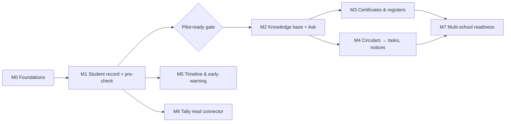

# 14 · Roadmap & Milestones

| Field | Value |
|---|---|
| Version | 0.12 · 2026-10-21 |
| Approach | Module by module on a shared core; real school needs decide order after M1; no calendar commitments |
| Related | 01-BRD §7, §11, 02-PRD §3, 03-TRD, 12-Testing strategy, 16-Platform admin panel |
| Changes | 0.12 (2026-10-21): R2 waves R2-0..R2-3H marked built in the wave table and the R2 status line; R2-3I hardening status; penetration-test scope for the R2 public surface (`docs/security/pen-test-scope-r2.md`, NFR-SEC-007). 0.11 (2026-10-17): the version field caught up with the change list; the M1 exit list no longer calls invoice PDFs in progress (done in code, template v0 pending CA review, as the M1 table says). 0.10 (2026-10-14): R2 plan (scope, five build waves with file ownership and migrations, test plan, definition of done, owner questions and the owner's decisions D12-D30 of 2026-10-14); correction that the Ask screens are built; M7 online payment item superseded by R2 (ADR-0042). 0.9: M2 addendum: Ask conversations, context and per-user memory (ADR-0034; PO questions). 0.8: M5 status (attendance, marks, early-warning flags, notes and timeline built on the M5 branch; PO questions). 0.7: M4 status (circulars, tasks, parent notices built on the M4 branch; PO questions). 0.6: M1 status updated for everything merged up to `cc818b3` (promotions, DEK rotation, break-glass support sign-in, synthetic students, test gates, SEC-023 Terraform, worker image and Chromium sandbox); new M2 status; owner decisions for SEC-012 and SEC-023 (2026-09-27) recorded. 0.5: M1 status (built per scope item, M1 security controls, remaining work, decisions needed, pilot-gate items checkable in code) after §2 M1, verified against code and tests. 0.4: M0 decisions 1, 3, 4 and 5 settled by the product owner (ADR-0020); decision 2 stays open. 0.3: M0 status (built per task, remaining work, decisions needed, pilot-gate status) after §2 M0; Task 5 lists all definer functions. 0.2: M0 adds the platform admin panel with minimal billing (C14), school setup and user admin UI, synthetic data as tasks; M0 task order changed; M0 exit criteria and pilot gate add platform checks; promotions and invoice PDFs in M1; M7 no longer carries basic billing. 0.1: baseline |

---

## 1. Milestone overview

Order after M2 is decided by the design partner's answer to "which task takes most of the office's time?"

### English first; Telugu moved to later (ADR-0036, product owner 2026-09-30)

"Forget about Telugu for now; deal with English first." Every milestone below ships in **English**. Telugu output (UI, notices, notifications, certificates and registers, AI answers, summaries) is **hidden, not deleted**, behind `SOS_TELUGU_ENABLED` (default `false`); the "EN/TE" items below are done for the code but shown in English only while the switch is off. Telugu *input* still works (Telugu questions answered in English, Telugu-script search, transliteration matching, Telugu register values). Telugu tests and eval gates keep running with the switch on (docs/12 §4.0.8, docs/06 §13.8).

**Bring Telugu back (checklist):**

- [ ] Product owner decision recorded in a new ADR (superseding ADR-0036 in part or whole)
- [ ] `SOS_TELUGU_ENABLED=true` in one non-production environment first (API, worker and web read the same variable)
- [ ] `make eval EVAL_ADAPTER=app-fake EVAL_SUITE=full` green and the live Telugu run on Vertex AI (docs/06 §13.7) with the Telugu soft gates `--fail-on-soft`: language match, follow-up language, memory preference, TE and code-mixed circulars
- [ ] A fluent Telugu reviewer signs off answers (30 proposed), notices (10), notifications, certificates and register print views; the Telugu catalog (`messages/te.json`) completed for keys added while it was off
- [ ] Knowledge: the switch picks `answer_system` v2, `followups` v1, `circular_reading` v1 and `parent_notice` v1 (`telugu_prompt` in the configs) and the `te` not-found and memory replies; re-check these prompts against today's English versions and write new versions if the English ones gained rules
- [ ] Print: Noto Sans Telugu loaded again; the worker's Telugu PDF smoke test (docs/10) and "no clipped glyphs" checks on real printers
- [ ] Docs: remove the "deferred: hidden while `SOS_TELUGU_ENABLED` is off" notes from 01, 02, 03 and the "English first" notes elsewhere
- [ ] Staff training material and parent-facing templates in Telugu; production switched on per the new ADR

## 2. Milestones

### M0 · Foundations (the core that never changes)
**Scope:** monorepo skeleton · local stack (compose: Postgres+pgvector, Valkey, SeaweedFS) · CI with all merge gates · Terraform staging env · OIDC login via BFF with MFA for privileged roles (ADR-0018) · tenancy + academic structure · RBAC with scopes + `require()` · RLS on all tables + catalog tests · database roles and privilege separation (ADR-0013) · hash-chained audit + daily verification · structured logging with redaction · OTel tracing · **platform admin panel (C14) with minimal billing: manual payments, GST invoices** · fleet heartbeat for dedicated hosts · school setup and user admin UI · synthetic data generator · security headers/CSP.
**Exit criteria**
- Cross-tenant suite, route-enumeration and authz matrix pass in CI
- Audit chain verification job green; tamper test detects modification; sequence concurrency test green
- Platform suites pass in CI: privilege separation, definer allowlist, composite FKs, admin panel authz matrix, heartbeat (12 §4.8–4.13)
- In staging, a shared-tier school is provisioned end to end from the admin panel and its owner signs in with MFA
- In staging, an invoice is generated, issued with a correct financial-year number and marked paid with a manual payment
- A staging dedicated host (`deploy/dedicated/compose.yaml`) sends accepted heartbeats; stopping it raises the `unreachable` alert
- Deploy to staging fully through the pipeline (no manual console changes)
- `make check` < 10 min on CI
- SEC-001..011 and SEC-026..028 implemented; SEC-029 for offboarding

### M0 status (2026-09-26)

The M0 code is merged on the session branch (not yet on `main`). What exists, per build task (§4), with the main requirement IDs:

| Task | Built | Requirements |
|---|---|---|
| 1 · Repo scaffold | uv + npm workspaces monorepo; Makefile (`install`, `dev`, `down`, `logs`, `migrate`, `db-shell`, `seed-synthetic`, `openapi`, `test`, `test-api`, `test-web`, `test-security`, `migration-check`, `e2e`, `lint`, `format`, `typecheck`, `security`, `eval` (stub until M2), `check`); `docker-compose.yml` (`db`, `valkey`, `s3`, `s3-init`, `migrate`, `api`, `worker`, `beat`, `web`, `oidc` in profile `dev`); `.env.example`; pre-commit; import-linter contracts | NFR-MNT-002 |
| 2 · CI pipeline | `.github/workflows/ci.yml` (jobs `lint`, `typecheck`, `test (test-api, test-web)`, `migrations`, `authz-suite`, `security`, `ci-config`, `terraform`, `images`, required check `ci-ok`), `nightly.yml`, `deploy-staging.yml`, `deploy-dedicated.yml`; CODEOWNERS; Dependabot; zizmor/actionlint | SEC-009, NFR-SEC-* |
| 3 · DB bootstrap | `infra/db/bootstrap.sql` (six roles, none with BYPASSRLS; schemas; extensions); `0001_baseline`; RLS catalog, definer allowlist and privilege-separation tests | SEC-001, SEC-002, SEC-026 |
| 4 · Tenant session | `tenant_session()`, `context_free_session()`, `platform_session()`; two-tenant isolation harness | FR-TEN-001, FR-TEN-002, SEC-001 |
| 8 · Logging/telemetry | Structured JSON logging with field allowlist and `redact()` (Verhoeff Aadhaar, phones, emails); OTel tracing with allowlisted attributes | SEC-008, NFR-OBS-001, PRV-015 |
| 7 · Audit | `0002_audit`: partitioned append-only tenant chain + platform chain; `record()`, `record_platform()`, `verify_chain()`; daily signed S3 archive and verification; partition CLI; school audit viewer and verify routes | FR-AUD-001..005 (CSV export pending), SEC-007 |
| 5 · Core schema | `0003_core_schema` with composite FKs and seven definer functions; `0007_accept_invitations` (ADR-0019) | FR-TEN-001..003, FR-TEN-010, FR-IAM-010..013 |
| 6 · AuthZ | `0004_authz_seed`; `permissions.yaml` + `roles.yaml`; `require()` with scopes, implicit `session.authenticated`, 60 s snapshot cache; route enumeration, generated matrix, BOLA | FR-IAM-010..014, SEC-003, SEC-005, SEC-015 (M0 resources) |
| 9 · Identity + BFF | API: OIDC access-token verification (JWKS), service token, MFA and step-up (`428`), `/me*` routes incl. school picker and invitation acceptance. Web: PKCE login for staff and operators, encrypted server sessions in Valkey, CSRF, refresh rotation with reuse detection, idle/absolute timeouts, step-up, session list/revoke | FR-IAM-001..006, FR-IAM-013, SEC-004..006 |
| 10 · Terraform | Modules `network`, `rds`, `rds_backup_replication`, `redis`, `s3`, `s3_bucket`, `kms`, `secrets`, `ecr`, `ecs_cluster`, `ecs_service`, `alb_waf`, `cognito` (+ pre-token Lambda), `observability`, `ci_oidc`, `shared_platform`, `dedicated_host`; roots `bootstrap`, `envs/staging`, `envs/prod`, `envs/dedicated-template`, with `terraform test` files. Validated in CI; never planned or applied against AWS | SEC-009, SEC-011, SEC-022, SEC-030 (partly) |
| 11 · Platform admin panel | 11a–11g backend (`0005_platform`, `0006_ops`, 70 control-plane routes + the fleet heartbeat, heartbeat, billing jobs, usage, flags, announcements, support, bootstrap-owner CLI); 11h web screens under `/[locale]/platform/*` (dashboard, schools, provision, plans, subscriptions, invoices, usage, flags, fleet, announcements, support, break-glass, operators, audit) | FR-PLT-001..030, SEC-026..029 |
| 12 · School setup UI | Structure (years, classes, sections), users (invite, roles, scopes, status), Plan & billing, audit log pages; EN/TE messages | US-102, US-202, US-1204, FR-AUD-005 |
| 13 · Synthetic data | `make seed-synthetic`: deterministic schools, academic structure and staff for every system role with AP name variants and overlapping names across schools; each first owner created through the production path (owner invite while provisioning → activate → invitation acceptance), audited on both chains | NFR-MNT-002, docs/12 §3 |

**Remaining before M0 exit** (exit criteria above):
- **CI on GitHub:** the workflows have never run on GitHub (pushing the branch is currently blocked); `ci-ok` must go green and `make check` must be timed (< 10 min).
- **Branch protection / rulesets** on `main` with `ci-ok` required and CODEOWNERS review (owner handle in `.github/CODEOWNERS` is a placeholder).
- **AWS:** accounts, `terraform plan/apply` for `bootstrap` and `envs/staging`, deploy pipeline secrets; then the staging exit checks (shared school provisioned end to end, owner signs in with MFA, invoice issued and paid, dedicated host heartbeat and `unreachable` alert, deploy fully through the pipeline).
- **Deploy configuration vs settings names:** **done** (checked 2026-09-29): Terraform `shared_platform` and `deploy/dedicated/compose.yaml` pass the names `app/core/config.py` reads (`SOS_KMS_DATA_KEY_ARN`, `SOS_AUDIT_SIGNING_KEY_ARN`, `SOS_CONTROL_PLANE_URL`, `SOS_HEARTBEAT_KEY`/`_ID`, `SOS_DEDICATED_TENANT_ID`, `SOS_BILLING_SUPPLIER_*`), and every task, migrate included, gets the full settings (`c7373b1`); `tests/deploy/test_env_contract.py` parses the deploy files and runs the staging/prod guards per container.
- **Dedicated tier:** pin WAL-G in `deploy/dedicated/walg/walg.lock` (go-live precondition, 10 §15.3). The host-side provisioning command is done (`python -m app.platform.provision_dedicated`, `e48d475` · `tests/deploy/test_provision_dedicated.py`; 10 §15).
- **Identity:** Cognito Essentials has no threat protection, so breached-password screening (and adaptive login protection) must be built in the BFF/identity module or the pool moved to Plus (ADR-0018); FR-IAM-005 lockout auditing is not built.
- **Email delivery:** staff invite emails built (provider interface, SES, `POST /users/{id}/invitation-email`; off until `SOS_EMAIL_PROVIDER=ses` and an SES identity exist). Still open: owner invite emails from the control plane, billing reminders (FR-PLT-019), usage-threshold notifications (FR-PLT-021), SES identity, DKIM and `ses:SendEmail` permission in Terraform.
- **Audit:** CSV export of the school audit log (FR-AUD-005): **done** (API `GET /audit/export`; web download button with the current filters and step-up, `4115f30`, `apps/web/src/features/school/AuditExportButton.tsx`).
- **Usage meters:** students, storage, documents and AI counts are 0 until `sis`/`kb` exist (M1+; `core.tenant_usage_summary` and the `definer_access` allowlist grow then).
- **Security testing:** ZAP baseline (nightly job skips until staging exists); Schemathesis contract tests. Done (checked 2026-09-29): axe (WCAG 2.2 AA) and keyboard checks in Playwright, and e2e well beyond the signed-out smoke test (signed-in school and platform pages, M1 journeys, Ask the school, responsive layout), which now run on every pull request (`e2e` jobs in `ci.yml`, part of `ci-ok`). The first full `make security` run (2026-09-29) found no dependency CVEs (pip-audit, npm audit, trivy fs) and no IaC misconfigurations (trivy config); gitleaks history hits were reviewed false positives (`.gitleaksignore`); semgrep's repo rules found string-built SQL in `app/core/purge.py` and `app/students/rotation.py` (fixed) and a reviewed RLS toggle in `0014` (suppressed with reason). The registry rulesets `p/python`, `p/typescript` and `p/owasp-top-ten` could not be fetched from the build sandbox and still need a first run on GitHub.
- **School support form** in the web app: **done** (`/support`: list, open a ticket, thread and reply; `apps/web/src/features/school/SupportScreens.tsx`).

**Decisions** (docs and code disagreed; product owner decisions of 2026-09-27):
1. **School-chain audit events for platform actions** — **settled:** guaranteed through a transactional outbox (`platform.tenant_audit_outbox`, queued in the platform transaction, delivered exactly once and in order per school by `platform.deliver_tenant_audit`); no definer function. [ADR-0020](adr/ADR-0020-control-plane-boundaries-and-guaranteed-audit-copies.md), 16 §16.
2. **Shared provisioning is not one transaction** (FR-PLT-002 says "in one transaction"): the first transaction is atomic and later steps resume idempotently (16 §5.4). **Still open:** amend FR-PLT-002, or change the code? (The school-chain `tenant.provisioned` copy is now queued atomically with the owner invite.)
3. **Suspended schools** — **settled:** the owner and principal keep `GET /me`, school choice, the sign-in event, Plan & billing and the full data export (FR-ADM-001, built); every other school route answers `403 tenant_suspended` for every role. One pinned allowlist in `app/authz/resolver.py` (16 §5.5).
4. **Control plane and tenant modules** — **settled:** `platform` may call `tenancy.service` only for tenant lifecycle (register, initialise keys, activate, suspend, reactivate, offboard, usage counts) and never reads tenant data; enforced by `tests/platform/test_boundaries.py` (CLAUDE.md §4, ADR-0020).
5. **ADR process** — **settled:** dated Amendments sections may record implementation facts that do not change the decision; any change to the decision needs a new ADR that amends or supersedes it (adr/README step 5).

**Pilot-ready gate (§3) status:** not started except where M0 code covers controls: SEC-001..011 and SEC-026..029 are implemented in code and tests (SEC-029 emergency break-glass workflow is M1; SEC-011/SEC-022/SEC-023 exist only as unapplied Terraform); SEC-012..017, SEC-021 are M1; SEC-024 restore drill, incident rehearsal, DPA/DPIA, ZDR request, production accounts with two platform owners, CA confirmation of invoice format and GST, and staff training are all open.

### M1 · Student record, onboarding and pre-check
**Scope:** promotions with preview/commit/undo (FR-TEN-011) · invoice PDFs (before the first paid invoice) · students, enrolments, guardians · attribute catalog + per-source values + canonical projection · Excel/CSV/Sheets import with mapping, validation, commit, revert · register-photo extraction with verification queue (Aadhaar redaction) · DQ engine with DQ-001..012 and name matching · findings workflow · change requests (maker-checker) + correction memo · export profiles: `cisce-registration-2026` pre-check, `udise-plus` check sheet · bilingual reports (PDF/XLSX) · C3 field encryption · break-glass workflow.
**Exit criteria**
- Design partner's Class 9 and Class 11 batches imported and identity fields verified
- Pre-check report used before a real CISCE registration; post-submission corrections for pre-checked batches = 0
- DQ precision on seeded mismatches ≥ 0.95 for blocker/high rules
- SEC-012..017, SEC-021 and SEC-029 (emergency break-glass) implemented; pilot-ready gate passed before real data

### M1 status (2026-09-28)

Checked against the code and tests on the session branch up to the Ask screen merge `cfe93db` (migrations `0008_sis_students` … `0029_kb_v2`), not against earlier doc claims. Paths are relative to `apps/api/` unless they start with `apps/`, `infra/` or `deploy/`. "In progress" means another work package is open on it today.

| Scope item | Status | Evidence (code · tests) | Missing |
|---|---|---|---|
| Promotions with preview/commit/undo (FR-TEN-011, US-202 AC2) | **Done** | `0022_promotions`; preview, commit and undo within 24 h (API, merge `b8d2299`), year-end promotions screen with structure archive and class-teacher picker (`28eb754`); enrolment into archived structure refused (`8680d68`) | — |
| Invoice PDFs (before the first paid invoice) | **Done in code; template v0 pending CA review** | `app/platform/invoice_pdf.py` (template v0, Rule 46 fields), `invoice_files.py` (render on queue `pdf` via `app/core/pdf.py`, idempotent per invoice, audit), `invoice_storage.py` (control-plane prefix `platform/invoices/`), `GET /platform/invoices/{id}/download-url`, migration `0029_invoice_pdfs` (16 §5.8.1); Terraform wires `SOS_BILLING_SUPPLIER_ADDRESS`, `SOS_PLATFORM_INVOICE_BUCKET` and the task role's `platform/invoices/*` | CA sign-off of the layout (16 §19 Q2, Q3, Q11); panel download button; emailing to schools (Q13) |
| Commercial catalogue: one-time fee, AI answer bundles, overage (ADR-0038, 2026-10-01) | **Done in code** | Migration `0041_billing_catalogue` seeds Shared (₹4,999 a month + ₹15,000 one-time) and Dedicated (₹9,900 + ₹49,000) and the AI bundles Lite/Standard/High (300/1,000/3,000 answers, ₹699/₹1,499/₹3,499, ₹1.50 each extra); `app/platform/billing.py` (fee on the first invoice once, bundle line in advance, overage for the previous calendar month once), `usage.py` (billable AI answers counted in the school's own session; heartbeat `ai_answers`), routes `GET /platform/ai-bundles`, `PUT`/`DELETE /platform/subscriptions/{id}/ai-bundle`; plans and subscriptions screens · `tests/platform/test_catalogue.py`, `test_boundaries.py`, web `actions.test.tsx` (16 §5.6, §5.7, §10.2, §11) | Owner decisions 16 §19 Q15 (cached answers count?), Q16 (annual plans, quota alerts), Q17 (`usd_inr_rate`); school-side Plan & billing page shows the bundle (built: `ai_bundle` on `GET /tenant/billing`, 16 §5.18); public `/pricing` copy still says "price agreed" and "your own server" |
| FR-PLT-005 Offboarding deletion, crypto-shredding, certificate (ADR-0029) | Done | Export gate, deletion job as `sos_purger` in the school's own session (`0032_offboarding`), verification over the whole catalog, key destruction, dedicated teardown confirmation, 30-day deadline alerts, bilingual certificate (Telugu wording pending review), retained audit chain deleted after 366 days · `tests/tenancy/test_offboarding_purge.py`, `tests/platform/test_offboarding.py`, `tests/platform/test_deletion_certificate.py` | **Open infra item:** noncurrent object versions deleted before offboarding keep their 90-day expiry (needs `s3:ListBucketVersions`/`s3:DeleteObjectVersion` on `t/*` for the worker, or a lifecycle change). Staff sign-in accounts: identity rework ADR (docs/16 §5.5 TODO). Telugu wording review (docs/16 Q14) |
| Students, enrolments, guardians (FR-STU-001..008, 010..012; US-301..303) | **Done** | `0008_sis_students`; `app/students/`; `tests/students/`; BOLA and scope rows in `tests/security/test_bola.py`; web `/students`, `/students/new`, `/students/[id]` with guardian, enrolment editing and corrections (`a0174d3`, `808610f`) | — |
| Attribute catalog, per-source values, canonical projection (FR-STU-002..006) | **Done** | `app/students/attributes.yaml` seeded into `sis.attribute_definitions`; append-only values with supersession and verification; `canonical.py` resolves on read with the admission-register anchor (BR-01) · `tests/students/test_definitions.py`, `test_canonical.py`, `test_service.py`, `test_values_changed_event.py` | — |
| Excel/CSV/Sheets import with mapping, validation, commit, revert (FR-IMP-001..007; US-401) | **Done** | `0012_imports`; `app/imports/` · `tests/imports/` (every FR-IMP-001..007 ID, SEC-013, SEC-015, SEC-017, 2,000-row timing); students own the revert, `import.reverted` notice (`2a1d841`); web `/imports` | — |
| Register-photo extraction with verification queue and Aadhaar redaction (FR-IMP-020..024, PRV-016; US-402) | **Partial** | `0016_extraction`, `0018_extraction_redaction`; `app/extraction/` (provider interface, queue, confirm/reject with the page as evidence, page-image black-out and re-read) · `tests/extraction/` (FR-IMP-020..024, PRV-016, SEC-008); web `/register-photos` | **No real provider**: only `fake` (local/ci); staging/prod default to `not-configured` (`SOS_EXTRACTION_PROVIDER`). **PDF pages refused** (`accepted_mime_types` is JPEG/PNG; no approved rasteriser) although FR-IMP-020 lists PDF |
| DQ engine, DQ-001..012, name matching (FR-DQ-001..006) | **Done** | `app/dq/` (12 rules, matching, EN/TE explanations, on-demand and incremental runs) · `tests/dq/` incl. `test_precision.py` ≥ 0.95 and the robust 2,000-student timing test (`42fd217`) | — |
| Findings workflow (FR-DQ-020; US-502) | **Done** | `/findings/{id}/resolve` · `/waive` (`dq.findings.waive`, reason) · `tests/dq/test_engine.py`, `test_api.py`; web `/findings`, `/findings/rules`, `/findings/runs/[id]` | — |
| Change requests (maker-checker) and correction memo (FR-CR-001..005, SEC-014; US-601) | **Done** | `0014_change_requests` (DB CHECK against self-approval); `app/changes/` incl. `memo.py` (print-ready bilingual HTML) and daily expiry · `tests/changes/` (`test_SEC_014_database_refuses_self_approval_*`, FR-CR-001..005); web `/change-requests` ("Waiting for me" / "Asked by me" tabs on `waiting_for=me` / `requested_by=me`, 2026-10-18) | — |
| Export profiles `cisce-registration-2026` pre-check and `udise-plus` check sheet (FR-EXP-001; US-501, US-901) | **Partial** | Profiles in `app/dq/config/profiles/*.yaml`, layouts in `app/exports/config.yaml`, `0017_exports`, `0019_export_access` (ADR-0021) · `tests/exports/test_config.py`, `test_service.py`, `test_report.py`; web `/exports/new/precheck` | Field lists are **minimal placeholders** (`TODO(board formats)`, `TODO(portal formats)`): exact council and UDISE+ field order, codes and date formats still to be taken from the official formats |
| Bilingual reports PDF/XLSX (FR-EXP-002..004, SEC-017) | **Done** | `app/exports/report.py`, `pdf.py`, `tables.py` · `tests/exports/`; worker image with chrome-headless-shell, export lifecycle tag and SSE-KMS (`343938c`); Chromium sandbox on (ADR-0025: EC2 `pdf` capacity on the shared tier, seccomp + AppArmor on dedicated hosts, `c6f723b`); CI renders sandboxed | Staging render on real infrastructure (needs AWS) |
| C3 field encryption (SEC-012, FR-STU-007) | **Done** | `app/core/crypto.py`, `app/students/crypto.py` · `tests/students/test_crypto.py`, `tests/tenancy/test_key_wrapping.py`; DEK rotation, background re-encryption and guarded retirement (`0026_dek_rotation`, `python -m app.tenancy.rotate_keys`, `98c281c`). Policy settled 2026-09-27: yearly and after a suspected incident, platform owner + second approver, retired keys kept until offboarding (07 §8, 10 §9.1). `kb.queries` is re-encrypted too (`register_reencryptor("kb_queries", …)` in `app/knowledge/service.py`, `8fbb007` · `tests/knowledge/test_query_reencryption.py`) | Technical enforcement of the second approval (procedural today) |
| Break-glass workflow (SEC-021, SEC-029; US-103, FR-OPS-004) | **Done** for the shared tier | `0011_breakglass`; `app/breakglass/`, `app/platform/breakglass.py`, `app/authz/breakglass_guard.py` · `tests/breakglass/`; web `/break-glass`, `/platform/break-glass`. Operator sign-in to the school (ADR-0023 option C, merge `0c67673`): `0027_identity_issuer` (expand), support verifier and resolver, `POST /breakglass/support-session`, web `/bff/auth/support/*` · `tests/identity/test_support_tokens.py`, `tests/breakglass/test_support_signin.py`; Cognito support app client per environment and per dedicated host in Terraform (`modules/cognito_support_client`, unapplied) | Contract migration for `core.users.idp_issuer` (later release); dedicated hosts: requests cannot reach them (decision 6); emergency path for an operator never approved (decision 7) |
| School data export and retention settings (C12, US-1201; FR-ADM-001, FR-ADM-002; BR-08) | **Done** (FR-ADM-001/002); FR-ADM-003..006 not written | `0031_admin`; `app/admin/` (full export worker on queue `exports` streamed to the bucket, 24-hour link, hourly purge; retention bounds in `app/admin/retention.yaml`, provider in `app/core/retention.py` read by `imports.purge_raw_files`, the export expiry and `notifications.purge_read`); export routes on the suspended-school allowlist · `tests/admin/` (config, archive, service, API, retention, migration round trip, log redaction, public additions), authz matrix, BOLA, `tests/authz/test_suspended_allowlist.py`, `tests/api/test_suspended_school.py`, `apps/worker/tests/test_admin_routing.py`; web `/settings/data-export`, `/settings/retention` | FR-ADM-003..006 are referenced by US-1201 but not written in 03-TRD. Not in the archive yet: parsed import rows, extraction items, notifications, pre-check export records, knowledge questions. Owner questions below (decision 9). Done 2026-09-29: `kb_queries` is purged after 180 days by the daily `knowledge.purge_queries` job (`query_log.retention_days` in `app/knowledge/config/models.yaml`; `tests/knowledge/test_query_retention.py`); the Exports and Imports screens no longer state fixed 7/90-day periods: the export pages show the school's period (from the export's own dates, or `GET /admin/retention` for `tenant.settings.manage` holders) and otherwise say it ends with the school's retention period (en + te) |
| Sheet editor for imports and documents (FR-IMP-008, FR-IMP-009, FR-DOC-009..011; US-701) | **Done** (2026-10-03) | Sheet routes in `app/imports/` and `app/documents/` (view, edit, export); web `/imports/[importId]/sheet` and `/documents/[documentId]/sheet` (grid search, Tab out, pending cells, unsaved-changes guard, conflict reload, document preview) · `tests/imports/`, `tests/documents/`, `tests/core/test_logging.py` (sheet fields never logged), `apps/web/e2e/sheets.spec.ts` with axe | e2e run in CI |
| Exact search by APAAR ID (FR-STU-016; ADR-0037, PRV-020) | **Done** (2026-10-03) | `POST /students/search` with `apaar_id` (12 digits; exact match on current, not rejected values; same permission and scope as every search; never logged); "APAAR ID" field on the web students list · `tests/students/test_apaar_search.py` | — |
| Automatic deletions discarded after 1 day (FR-DOC-007, PRV-016; owner decision 2026-10-03) | **Done** | `documents.delete_for_retention` and the other automated purges tag objects `sos-lifecycle=discarded` (bucket rule `discarded-1d` in `modules/s3` and `modules/dedicated_host`); a person's delete keeps the 90-day recovery window; the `document.deleted` event carries `discard` (06 §4.8, 08 §7) · `tests/documents/test_tasks.py`, `test_storage_s3.py`, `test_documents_api.py` | — |
| AI budget from the AI answer bundle (FR-KB-011, NFR-CST-001, FR-PLT-013; ADR-0020 B2/B3, ADR-0038 C1) | **Done** (2026-10-03) | The bundle's included answers reach the school through `tenancy.set_ai_answer_allowance` when the bundle changes and in the daily `usage.collect_daily` reconciliation (`billing.sync_ai_allowance`); one alert at 100% on the first refusal of the month; `usd_inr_rate` set to the FBIL reference rate · `tests/knowledge/test_bundle_budget.py`, `test_budget_reservation.py`, `tests/tenancy/test_ai_allowance.py`, `tests/platform/test_catalogue.py` | Owner questions 16 §19 (Q19, Q20) |

**M1 security controls** (07 §15):

| Control | Status | Evidence |
|---|---|---|
| SEC-012 Per-tenant DEKs; C3 encryption | Done (rotation built; policy settled, second approval procedural) | see C3 row above |
| SEC-013 Aadhaar input rejection + Verhoeff redaction in pipelines | Done | `app/students/api.py` and `service.py` (422 `aadhaar_full_number_rejected`), `app/core/redaction.py`; `tests/imports/` (`test_SEC_013_*`), `tests/extraction/` (`test_FR_IMP_022_PRV_016_*`), `tests/exports/` (`test_invariant_4_*`), `apps/web/src/lib/aadhaar.test.ts` |
| SEC-014 Maker-checker with DB constraint | Done | `tests/changes/test_schema.py`, `test_service.py` (`test_SEC_014_*`) |
| SEC-015 Scoped repositories + BOLA per resource | Done for every M1 resource | `tests/security/test_bola.py` (`test_SEC_015_every_id_route_is_covered`, students, change requests, extraction, exports), scope tests per module |
| SEC-016 File upload controls | Done in code; browser uploads wired for staging/prod (`49e1eb1`); ClamAV service not deployed | `app/documents/filetypes.py`, `scanning.py` (ClamAV `INSTREAM`; dev scanner refused in staging/prod), `storage.py` (presigned POST with size range, SSE-KMS condition) · `tests/documents/` (`test_SEC_016_*`, FR-DOC-001..008) |
| SEC-017 Formula-injection-safe spreadsheets | Done | `app/exports/tables.py`, `app/imports/sheet.py` · `tests/exports/test_tables.py`, `tests/imports/` (`test_SEC_017_*`) |
| SEC-021 Break-glass visible to school | Done (shared tier) | see break-glass row |
| SEC-029 Two-person rule (offboarding M0, emergency break-glass M1) | Done | `tests/breakglass/test_breakglass.py`, `tests/platform/test_provisioning.py` |

**Remaining before M1 exit** (besides the items in progress listed above):
- **Invoice PDFs**: done in code (see the M1 table); the CA review of template v0 is still needed before the first paid invoice.
- **Extraction provider**: choose a real OCR/extraction provider by evaluation (FR-IMP-024), then add it; a new sub-processor needs an ADR and a privacy review (§5). PDF register pages need an approved rasteriser.
- **Official export formats**: replace the placeholder field lists of `cisce-registration-2026` and `udise-plus` with the council's and the portal's exact formats.
- **Usage meters**: students, storage and documents are still 0 (`core.tenant_usage_summary()` counts memberships, sections and years only); counting `sis`/`kb` rows means `definer_access` on those tables, which needs an ADR (CLAUDE.md §11).
- **Test gates**: done 2026-09-29: the whole Playwright suite (`make e2e` with `E2E_STAND_IN=1`: signed-out pages, signed-in school and platform pages, M1 journeys, Ask the school, axe, keyboard, responsive layout at 1366×768 and 375×812) runs on every pull request in two shards and is part of `ci-ok`; the nightly job runs the wide responsive sweep (`make e2e-audit`, ten viewports). Earlier: coverage gate `fail_under = 92`, a shuffled-order run and signed-in M1 journeys (`a0c1e93`).
- **Carried from M0 and still open**: email delivery beyond staff invitations (owner invites, approvals; invitation email through SES is built and its Terraform is ready, 10 §5.2), everything that needs AWS or GitHub (M0 status above). (The audit log CSV button, FR-AUD-005, is done.)
- **Human evidence for the exit criteria**: design-partner batches imported and verified, a real CISCE pre-check used, post-submission corrections counted. None can be ticked from code.

**Decisions needed** (owner):
1. **Promotions design:** settled in code (merge `b8d2299`, `0022_promotions`); no owner question left.
2. **Extraction provider:** candidate providers, residency (ap-south-1), cost ceiling and the evaluation set; new ADR.
3. **Export formats:** who supplies the official CISCE 2026 registration and UDISE+ formats, and whether M1 exits with the placeholders.
4. **Invoice PDF:** CA confirmation of the invoice layout and GST fields (16 §19 Q2–Q3) before the template is fixed; where the PDF lives (control-plane bucket, not a school prefix).
5. **Usage meters:** ADR extending `core.tenant_usage_summary()` (and `definer_access`) to `sis.students`, `kb.document_versions` sizes and document counts, or defer to M2.
6. **Break-glass on dedicated hosts:** deliver requests with the heartbeat response, or support shared tier only in M1.
7. **Emergency break-glass for an operator never approved anywhere** (ADR-0023 item 5, recorded as a deviation in its Amendments): the emergency path finds the operator's identity but cannot create it, because `core.create_user_for_invite` requires an inviter. Relax that definer guard for operator-issuer identities (new ADR), or keep failing closed.
8. **In-house identity (Proposed: [ADR-0030](adr/ADR-0030-in-house-identity-and-sessions.md)).** Owner decisions 2026-09-29: build our own sign-in, MFA and account management instead of Cognito, invite-only sign-up, and follow the user management of `bb3agency/calevate-site`. ADR-0030 follows that design (Argon2id passwords with a pepper, opaque server-side sessions with rotation and reuse detection, single-use e-mailed links) in a separate `auth` schema and role, keeps TOTP with recovery codes for privileged roles, lists where SchoolOS must differ, and asks 8 open questions (first: may we use the same security libraries and an e-mail service as calevate-site). Nothing else in the docs changes, and the Cognito Terraform should not be applied, until it is accepted. Recommended to land before the first staging deployment.
9. **Full export and retention (FR-ADM-001/002, built 2026-09-29):** (a) restricted (C3) values are masked by default and included only when the owner ticks "include restricted details" (needs `student.read_sensitive`); confirm, or decide the owner's export always carries them; (b) the Aadhaar-as-printed name, DOB and gender are never exported (same rule as the pre-check exports), so an offboarding school does not get them back; confirm; (c) the retention bounds (import files 7–90 days, export files 1–7, read notifications 30–90; shorten only) are engineering choices: confirm with counsel against DPDP Rule 8 (1-year minimum for some data) before real data; (d) write FR-ADM-003..006 or drop them from US-1201; (e) should the principal (who keeps the export routes while suspended) hold `tenant.export_all`? Today only the owner does (07 §6.2).

**Pilot-ready gate (§3), items checkable in code** (none ticked; each still needs verification in staging):
- SEC-001..017: implemented in code and tests (SEC-011 only as unapplied Terraform; SEC-016 needs ClamAV and SSE-KMS deployed).
- SEC-021: implemented (shared tier). SEC-022: WAF managed rule groups and rate-based rules in `infra/terraform/modules/alb_waf/main.tf` (auth rate limit on `/bff/auth/`), never applied. **SEC-023: Terraform written, never applied** (`modules/security_baseline`, `security_detection`: account trail with Object Lock, GuardDuty, Config, Security Hub, EventBridge alerts; merge `c53c2e4`). Owner decisions of 2026-09-27 recorded in 10 §5.1: prod COMPLIANCE 400 days kept, email alerts for the pilot with an upgrade path to paging, CIS CloudWatch.1-14 disabled with a recorded reason where the subscribed CIS version has them (v3.0.0 does not), the management-account trail is a manual step, HIGH Security Hub alerts after the first triage. SEC-024: dedicated-host drill script `deploy/dedicated/scripts/restore.sh` exists; no RDS restore drill script; no drill run.
- SEC-026..029: implemented in code and tests.
- Operator pool MFA ON: asserted by `infra/terraform/envs/prod/tests/prod.tftest.hcl`; not applied.
- Synthetic data never in prod: `make seed-synthetic` refuses outside `local`/`ci` (`tests/devtools/test_seed_synthetic.py`); the purge of prod itself is a human check.
- Everything else in §3 (restore drill, incident rehearsal, DPA/DPIA, ZDR, two platform owners, CA, data-handling permission, training) needs human evidence.

### M2 · Knowledge base and "Ask the school"
**Scope:** document upload (presigned), AV scan, extraction/OCR, chunking, embeddings (provider chosen by eval, ADR-0006), hybrid retrieval, record tools, answer generation with search-result citations, citation validation, SSE UI with source chips, feedback, verified answers, budgets + search-only fallback, eval harness with hard gates.
**Exit criteria**
- Hard gates pass (leakage 0, injection 0, citation precision ≥ 0.95, refusal ≥ 0.95)
- Soft gates met on full suite; p95 latency targets met in staging
- Office staff use Ask for real questions weekly at the design partner; ≥ 80% rated helpful
- SEC-018..020 implemented

### M2 status (2026-09-28)

Merged up to `cfe93db` (checked against code): `0021_kb_tables`, `0024_kb_metering` and `0029_kb_v2`; streaming answers (SSE `delta`/`final`), follow-up questions, four read-only tools, C3 retrieval for `read_sensitive` (SEC-018), verified-answer review and retire (FR-KB-030); the web Ask screen with source chips, draft preview, search-only status and verified-answer review; `app/knowledge/` with ingestion and Telugu-safe chunking (outbox → `ingest` queue), PDF text layer with pypdfium2 (ADR-0027), embeddings interface with per-tenant cache, offline fake and a Voyage adapter over httpx, hybrid retrieval with one ACL predicate in SQL before ranking, the LLM gateway (redaction, budgets, retries, circuit breaker, fake/live providers), read-only record tools, answer composition with citation validation, AI policy and metering, SSE ask API; RAG eval harness with hard gates (`evals/`, `make eval`, `app-fake` bridge). SEC-018..020 implemented in code and tests.

Contextual retrieval and reranking (PO approval 2026-09-30; ADR-0035 Proposed; docs/06 §4.11, §6, §13.6): built behind `SOS_KB_CONTEXTUAL_CHUNKS` / `SOS_KB_RERANK`, both **off**: contextual chunk headers through the gateway role `contextualize` (checked, redacted, metered per document, budget-aware, reused per version, hourly backfill), contextual full-text and keyword branches, a reranker interface with an offline fake and a Voyage adapter, migration `0040_contextual_retrieval`, and a 54-question eval set in EN/TE/mixed with a hard leakage gate (offline: recall@5 0.685 plain → 1.00 with contexts; leakage 0). Switching on waits for a live run meeting the §13.6 soft gates and, for a reranker, the sub-processor steps.

Not done: embeddings model chosen by evaluation on real providers (ADR-0006), live eval runs (incl. the contextual set, docs/06 §13.7) and p95 latency in staging, and every human exit criterion. (Feedback and verified answers exist in the API: `POST /knowledge/queries/{id}/feedback`, `/knowledge/verified-answers`.)

**LLM provider switched to Google Gemini on Vertex AI (ADR-0033, product owner decision 2026-09-30).** Built: per-role `provider` in `models.yaml` (all roles Gemini; each keeps its evaluated Anthropic `fallback`, switched only by a reviewed config change); the Gemini codec and Vertex REST transport (asia-south1, service identity via workload identity federation or a service-account key, fail-closed check that project caching is off, explicit context caches for static prompts only, thought-signature replay, structured output, images for extraction); provider-neutral `[n]` passage citations with server-side mapping and number checks; `SOS_LLM_*` settings with India-region, identity and ZDR start-up guards; offline Gemini-wire fake so CI and `make eval EVAL_ADAPTER=app-fake` run through the Gemini codec (all gates pass, same numbers as before); `make eval-live` (docs/06 §13.7). **Pending credentials:** live model selection per role (the configured models are provisional: `gemini-3.5-flash` for answer/notice/extraction, `gemini-3.5-flash-lite` for router/metadata/translation/circular and the Ask conversation roles (followups, summary, memory_screen, query_rewrite), `gemini-3.1-pro-preview` judge), the live gates of docs/06 §13.7 before any role goes live, Telugu quality sign-off, and staging p95 latency. Also open: Terraform for the Google project, workload identity pool and the new secrets (docs/10 §11.1 lists the manual steps); a vision register-extraction provider (FR-IMP-024) through the gateway.

**Questions for the PO (ADR-0033)** (safer behaviour chosen meanwhile):
1. Who owns the Google Cloud organization, the Vertex AI projects (`sos-ai-staging`, `sos-ai-prod`) and their billing account? Nothing can be evaluated live until they exist.
2. Is the prod project eligible for the abuse-monitoring prompt-logging exception, and who files the request? Until Google confirms, the DPIA must say that Google may keep prompts for abuse detection for a limited period; AI stays off for real schools until `SOS_LLM_ZDR_CONFIRMED` is set.
3. Region: product traffic is limited to asia-south1 / asia-south2, which currently excludes the newest and cheapest models (Gemini 3.8 Flash, 3.1 Flash-Lite were listed for the global and US/EU endpoints). Keep India-only (chosen), or accept the global endpoint for some roles after a privacy review?
4. (Deferred with Telugu, ADR-0036: only when Telugu comes back.) Who signs off Telugu and code-mixed answer quality and the Telugu parent notices on the live run (a fluent reviewer; 30 answers and 10 notices proposed)?
5. Register extraction with a vision model would send page images to Google; Aadhaar numbers on those pages must be blacked out first, which today needs the OCR geometry the vision model would provide. Use an in-region OCR pass for redaction first, or keep extraction on the non-AI path?
6. When may the Anthropic fallback (and its sub-processor entry) be removed: after one full term on Gemini without a switch-back (proposed)?
**Addendum 2026-09-30: Ask conversations, context and memory (backend; ADR-0034, FR-KB-012 as amended).** Built on the worktree branch: migration `0038_ask_conversations` (`kb.conversations`, `kb.user_memories`, `kb.user_memory_settings`; answer details, revisions, cache columns and `summarized` on `kb.queries`); conversation list, detail, rename/pin (`If-Match`) and delete; regenerate and edit-and-resend; SSE `status`, `followups` and `memory` events and `meta.conversation_id`, `title`, `cached`, `cached_from`, `summarized`; bounded history with a visibility re-check of every earlier answer, an async rolling summary (worker job), query rewrite before retrieval, follow-up suggestions; per-user memory with a three-step screen, pending suggestions and per-user and school switches; the documents-only answer cache; `search_my_conversations`; four new provider-neutral gateway roles (`query_rewrite`, `summary`, `followups`, `memory_screen`); DEK rotation, census, offboarding, retention and export wiring; security suites; conversation eval set with two hard gates (06 §13.5; app-fake passes all gates). The web screens are a separate change.

Not done: a live run of the four new roles and of the conversation eval against the real provider; latency of the rewrite in staging; tuning the memory screen and suggestion prompt with consented feedback; a per-school count of memory use for the DPO.

**PO questions (Ask conversations and memory):**
1. *Deleting a conversation.* Today it is hidden at once and its title and summary are erased, but its questions and answers stay in the encrypted query log until the 180-day purge (the record of AI queries, invariant 7). Should delete also remove the questions at once?
2. *Answer cache while the budget is used up.* A cached exact repeat costs nothing, so it is still served when the monthly budget is exhausted (but not when the school switched AI off). Confirm, or treat it like any AI answer.
3. *Memory in the full data export.* The owner's full export includes each staff member's memory items and switch (decrypted). Keep, reduce to counts, or leave memory out?
4. *Memory default.* Memory is on by default for schools (`ai_memory_enabled`) and users; suggested items are never used without confirmation. Should the school default be off until the principal turns it on?
5. *Legacy sessions.* A `session_id` sent by an older client that names someone else's conversation silently starts a new conversation rather than failing. Keep, or refuse with 404 once the new web client ships?
6. *Who else may see conversations.* Nobody but the owner can see a conversation or memory (not the principal or owner). Confirm that no supervisory view is wanted (the audit log already records every question with ids and counts).

### M3 · Certificates and registers
**Scope:** templates for TC, bonafide, study, conduct certificates (EN/TE, school formats) · serial numbers · automatic register entries · duplicate marking · print views of registers in familiar formats · certificate PDFs indexed as documents.
**Exit:** certificates issued in production with median time < 5 minutes; register entries reconcile with paper.

### M3 status (2026-09-29)

Built on the worktree branch, and not yet merged. The stories (US-1101..US-1108) and requirements (FR-CERT-001..014, FR-REG-001..005) are **proposed from the roadmap scope; the PO still has to confirm them**.

| Scope item | Status | Evidence | Missing |
|---|---|---|---|
| Certificate types and templates (EN/TE) | **Done (v1 layout)** | `app/certificates/config.yaml`, `templates.py`; TC, bonafide, study and conduct; letterhead in school settings | The official AP TC format. Fields SchoolOS cannot fill yet (e.g. caste/religion, which are C3) print as labelled blanks, marked `TODO(official format)`. No logo. |
| Serial numbers | **Done** | `0033_certificates` (`certificate_counters`, unique serials); gap-free under concurrency (`tests/certificates/test_service.py`) | A serial format per school (PO) |
| Maker-checker TC that ends the enrolment | **Done** | DB CHECK plus service; `students.withdraw_for_transfer_certificate` in the same transaction | — |
| Duplicates and cancellation | **Done** | DUPLICATE mark with the original serial and a reason; cancelled certificates keep their number | — |
| Register print views | **Done** | TC register, certificate issue register, admission and withdrawal register (A4 landscape, bilingual, step-up) | Checking against paper at the design partner |
| PDFs stored and indexed as documents | **Done** | Queue `pdf`, purpose `certificate` (C2, ACL by role), scanned and indexed | Whether certificate text should be answerable in Ask (PO) |
| Web | **Done** | `/certificates`, `/certificates/[id]`, `/students/[id]/certificates/new`, `/registers`; vitest; responsive e2e entries | e2e run in CI |
| Public verification (QR or serial lookup) | **Not built** | — | Needs a PO decision and an ADR (it would be a public route) |

Release notes: run `python -m app.identity.sync_system_roles --apply` after `0033_certificates`. The system-role fingerprint changed because of the four new permissions.

### M4 · Circulars → tasks and bilingual notices (English only while Telugu is hidden, ADR-0036)
**Scope:** circular metadata/deadline extraction · task list with owners and due dates · reminders · parent notice generator (EN/TE text + printable/image) for posting in existing groups.
**Exit:** ≥ 90% of circulars in a term processed with deadlines captured; staff confirm fewer missed tasks.

### M4 status (2026-09-29)

Built on the M4 branch (not yet merged; migration `0034_circulars` must be relinked after M3's `0033` before merge). Stories US-1601..US-1606 and FR-CIR-001..008, FR-TASK-001..008, FR-NOTICE-001..008 are written in 02-PRD C16 and 03-TRD §3.14, each *proposed from the roadmap scope; PO to confirm*.

- **Circular reading** (docs/06 §4.10): a circular is read after it is indexed (hook `INDEXED_HOOKS`, outbox, `ingest` queue) through the gateway with only its own Aadhaar-masked passages; metadata, an EN/TE summary with citation chips and deadline suggestions, each kept only if its quote is in the cited passage and writes the date. Failures end in "needs manual review" with a code; "Read again" up to 3 times.
- **Tasks**: suggestions become tasks only when a `circular.review` holder confirms them (owner, title, date editable); manual tasks for `task.manage`, who also edit open and in-progress tasks (title, owner, due date typed in the school's date format, details; only changed fields with `If-Match`; web added 2026-10-04, FR-TASK-003); my tasks and the school view; owners mark in progress / done; in-app reminders 2 days before and when overdue (daily beat 07:10 IST, `maintenance` queue, dedupe keys).
- **Parent notices**: AI draft in English and Telugu from a C1 circular (its passages and confirmed dates) or staff text (personal numbers refused), edited by staff, approved by `notice.approve`, then copied or downloaded as an A4 PDF / PNG made by Chromium with Noto Sans Telugu (`pdf` queue, files kept 6 days, made again on request). SchoolOS never sends it.
- **Data, access, audit**: four RLS tables (docs/05 §6.3), six permissions (07 §6.2), 19 routes (09 §4), audit per action with IDs and codes only, metering features `circulars` / `notices`, offboarding purge.
- **Web**: Circulars inbox and detail with source chips, Tasks, Notices list and editor (EN/TE, print, copy, download), nav section "Work", bell links, `circulars`/`tasks`/`notices` messages in EN and TE.
- **Eval** (docs/06 §13.3): 24 synthetic circulars, 36 deadlines; hard gates recall ≥ 0.90, precision ≥ 0.90, citation validity 1.00, hallucinated 0. `app-fake` run: recall 0.944, precision 1.00, citation validity 1.00, hallucinated 0.

Not done: a live-model eval of `circular_reading` and `parent_notice` (the offline numbers measure the application's controls with a heuristic stand-in, not a model; since ADR-0033 the live run is on Gemini, `make eval-live`); email reminders (the notifications email interface sends invitations only; FR-TASK-008); OCR for scanned circulars (they end in manual review with `no_text`); an Ask tool for "what's due this week"; retention periods for tasks and notices; every human exit criterion (≥ 90 % of a term's circulars with deadlines captured at the design partner, fewer missed tasks).

**Questions for the PO** (safer behaviour chosen meanwhile):
1. `notice.approve` is granted to owner and principal only; should office admins approve?
2. Any phone number in a notice is refused, including the school office landline; allow an office number configured per school?
3. Email (or SMS) reminders for tasks: needed for the pilot?
4. "Read again" is limited to 3 attempts per circular version; enough?
5. People who confirm suggestions see every active staff member's name in the owner list; acceptable, or limit to their own section's staff?
6. A task owner who cannot see the source circular sees the task without its citation; acceptable?
7. Only C1 circulars can be turned into parent notices (C2/C3 refused); confirm.
8. Rendered notice files are kept 6 days (the exports bucket rule is 7); confirm, and set retention for tasks and notices (kept for the life of the school today).
9. Approve the live-model eval budget before the pilot.

### M5 · Student timeline and early warning
**Scope:** attendance and marks import · per-student timeline · ABC indicators (attendance, behaviour notes, course performance) · flags with assigned owner and intervention log · purpose limits (08 §4) · AP three-consecutive-absence follow-up support.
**Exit:** pilot with class teachers; ≥ 90% of flags actioned within 7 days; DPIA updated.

### M5 status (2026-09-29)

Built on the M5 branch (not yet merged; migration `0035_student_insights` has `down_revision = "0034_circulars"` and must be relinked with M6's `0036` before merge). Stories US-1701..US-1709 and FR-ATT-001..005, FR-MRK-001..005, FR-EW-001..018 are written in 02-PRD C17 and 03-TRD §3.15, each *proposed from the roadmap scope; PO to confirm*.

| Area | State | Where | Open |
|---|---|---|---|
| Attendance (mark, month register, sheet import) | **Done** | `app/academics`, `/attendance`; sheet deleted once read; A4 landscape register | Checking the register layout against the paper register at the design partner |
| Exams and marks (entry, grid, sheet import) | **Done** | `app/academics`, `/marks`; overall % per exam (absent papers left out) | Grading scales and CCE/FA/SA structure (not modelled) |
| ABC indicators and rules | **Done** | `app/insights/engine.py` (pure), `rules.yaml` v1; daily beat and after each write | Thresholds and bounds (PO) |
| AP three-consecutive-absence follow-up | **Done** | Rule `attendance_streak` (cannot be switched off), flag to the class teacher, due in 7 days, overdue reminder | The official definition (does a leave day end the run? holidays?) |
| Flags, owners, intervention log | **Done** | `/flags`, `/flags/[id]`: my flags and the school view, actions, close, reassign, erase | — |
| Behaviour notes and the student timeline | **Done** | Timeline tab on the student profile (class teacher and principal only), A4 print | — |
| Purpose limits (08 §4) | **Done** | Scope intersection, no export route, no AI (import-linter), audited reads, fixed retention, `sos_readonly` revoked | Legal review of the education exemption |
| Exit metric (≥ 90 % of flags actioned within 7 days) | **Measurable** | `GET /insights/summary` (`actioned_on_time` / `raised`) and the flags screen | The pilot itself |
| DPIA | **Inputs written** | 08 §10 (M5 table) | The school's DPIA and sign-off |
| e2e | **Listed, not run here** | `e2e/support/responsive.ts` and stand-in data for the four pages | Run in CI (no Playwright browsers in this environment) |

Release notes: after `0035_student_insights`, run `python -m app.identity.sync_system_roles --apply` (new grants) and `--prune` (the owner loses `insights.read`, PRV-004). The system-role fingerprint changed.

Not done: attendance by period (one status per day only); a school calendar (a school day is a day with at least one mark in the section); parent-facing messages about flags (by design none are sent); a counsellor role; Telugu register codes in sheets (only P/A/L/LV and the English words are read; the Telugu codes used on paper were not verified); every human exit criterion.

**Questions for the PO** (the most restrictive behaviour is built meanwhile):
1. Confirm US-1701..US-1709 and the FR-ATT/FR-MRK/FR-EW requirements (all proposed from the roadmap scope).
2. The owner (management) no longer sees insights, only a principal and the class teacher of the student's current section do (PRV-004). Should management see counts only, and should a counsellor or vice-principal role be added?
3. Insights need `student.read_sensitive` as well as `insights.read`, both reaching the student's current section (the default class teacher and principal roles have both); a custom role with only `insights.read` sees nothing, and a student not placed in a section this year has no visible insights. Confirm, with the default role grants in 07 §6.2.
4. Default thresholds and bounds: 3 absences in a row (2–5), attendance below 75 % over 30 marked days (60–90), marks below 35 % (25–50), a fall of 15 points (10–30), 3 concern notes in 30 days (2–5); due in 7 days. Confirm, and confirm that the AP rule cannot be switched off.
5. The AP follow-up definition: consecutive **marked** school days; a leave, late or present day ends the run. Confirm against the department's circular.
6. FR-MRK-005: absent papers are left out of the overall percentage (so illness is not read as low performance). The first draft said "absent counts as 0"; confirm.
7. Retention: behaviour notes 365 days after their date, closed flags 365 days after closing, fixed (not configurable). Confirm the periods and whether schools may shorten them.
8. Erasure: the principal erases a note or a flag on a parent's request or for an error. Who handles a parent's request, and should the parent be told?
9. Behaviour notes can be dated up to 60 days back; action notes are optional. Confirm.
10. Which Telugu attendance codes appear on the paper registers (to accept them in sheets)?
11. Should exam coordinators see the course-performance flags of students (they record marks but do not see insights today)?

### M6 · Tally read connector
**Scope:** edge agent (Windows service) reading TallyPrime via XML over HTTP on localhost · configured ledgers only · sync to SchoolOS · `get_fee_dues` tool for accountant/management.
**Exit:** fee-due questions answered from synced Tally data; accountant confirms figures match Tally.

### M6 status (2026-09-29)

Built on the M6 branch, **behind flag; ADR Proposed** (not yet merged; migration `0036_tally` revises `0034_circulars` and must be relinked after M5's `0035` before merge). Stories US-1801..US-1805 and FR-TALLY-001..010 are written in 02-PRD C18 and 03-TRD §3.16, each *proposed from the roadmap scope; PO to confirm*. The per-school flag `tally.connector.enabled` defaults off and must not be switched on anywhere before ADR-0032 is accepted.

- **Edge agent** (`apps/edge-agent`, 10 §13): Windows service (WinSW) that sends only `Export` requests to Tally on localhost, parses XML safely, keeps its credential in DPAPI and syncs complete snapshots with a stable batch id; CI on Linux and Windows.
- **Server** (`app/tally`, 05 §7.4, 09 Tally connector): one-time enrolment codes (owner, step-up), signed agent requests with replay and rate limits (07 §3 TB9), key rotation and revocation, group selection enforced on sync, idempotent snapshots, person-made ledger ↔ student links, fee dues, silent-agent notices, full export and offboarding purge. Two permissions (07 §6.2).
- **Ask**: `get_fee_dues` (06 §7), school-wide `finance.read` only, linked ledgers only; eval gates in 06 §13.4 all pass on `app-fake`.
- **Web**: `/settings/tally` (status, agents, groups), `/settings/tally/ledgers` (linking), `/fees` (dues), EN and TE; menu items only while the connector answers.

Not built: the MSI installer and code signing; signed auto-update; exposure of `/api/v1/edge/tally/*` in the ALB and the dedicated Caddyfile (10 §13); bill-wise (term-wise) dues; a live-model fee eval; an e2e run of the new screens (listed in the responsive suite, not run in this change); the human exit criterion (the accountant confirms the figures match Tally at the design partner).

**Questions for the PO and security review**: the ten questions of ADR-0032 (Tally version and ledger layout at the design partner, HMAC vs Ed25519, C2 vs C3 for fee data, who enrols, updates, an Excel fallback, bill-wise dues, the 48-hour silence window, class-teacher access).

### R1 status: APAAR consent, UDISE+ 2026-27 profile, transfer-in by PEN (2026-10-10)

Built on `wip/r1-apaar-udise` (docs/18 §3 R1.2-R1.3; ADR-0039; stories US-1901..US-1905 in 02-PRD C19; FR-APC-001..006, FR-STU-017..019, FR-IMP-010, FR-EXP-006 in 03-TRD; migration `0051_apaar_consent_pen`, to be re-chained at merge if another `0051` lands first):

- **APAAR consent register** (`app/apaar`): append-only decisions with the signed form as evidence, printable A4 forms with a refusal option in English or Telugu per school (D9), section summary and pending follow-up list, refused students skipped by DQ-009/DQ-022. Permissions `apaar.consent.read` / `apaar.consent.record`; run the system-role sync after the migration (ADR-0022).
- **PEN**: 11 digits, `tc_incoming` source, exact search, duplicate guard on create, values and imports, `POST /students/national-id-check` for transfer-ins.
- **UDISE+ 2026-27 profile**: Student Module field list with `portal_fields`, `source` URLs, `verified: false` (D3); export layout version 3.
- **Web**: `/apaar` consent screen, PEN check on the new-student form and detail page, PEN/APAAR import mapping.

Open: the consent wording and the court order are from secondary sources (check the official revised form); the Telugu form text needs a native reviewer; the UDISE+ field list awaits a school's portal screen or the official 2026-27 DCF; the BSEAP readiness diff and the APAAR failure list are a separate R1 work item (`app/dq/readiness*`).

### M7 · Multi-school readiness
**Scope:** self-serve onboarding wizard · import templates library · online payment of SchoolOS invoices (ADR-0016, accepted with Razorpay 2026-10-14; parents paying schools is R2, ADR-0042) (basic billing already shipped in M0) · tenant admin improvements · support tooling beyond tickets · first dedicated-tier schools at scale (SEC-030 before the first one) · Stage 1 infrastructure (Multi-AZ, replicas, cross-account backups) · external pen test · published security overview for schools.
**Exit:** 5 schools live with < 1 week onboarding effort each; SLOs met for 2 consecutive months.
*(The import templates library was pulled forward into R1.5, below.)*

### R1 · Board and portal readiness (2026-27 plan, docs/18 §3)

R1 status, part C (`wip/r1-boards-imports`, 2026-10-10; ADR-0041 Proposed):

- [x] Boards per school (`BSEAP`, `CBSE`, `CISCE`) and per class in school settings; profile lists filtered by board (FR-TEN-020, FR-TEN-021, US-203). Migration `0052_boards_import_presets` (column grant only).
- [x] CBSE registration (IX/XI) and LOC (X/XII) profiles and pre-check layouts; CISCE ICSE/ISC 2026-27 profile superseding the 2026 one (FR-DQ-030..032, FR-EXP-007, US-503). **All `verified: false`** (owner decision D3): field lists, lengths and codes come from secondary public sources; confirm with a pilot school.
- [x] Import template library: blank SchoolOS template, register Excel, UDISE+ student list, generic ERP export; header-only XLSX downloads; preset picker in the mapping step (FR-IMP-030..032, US-403). No MyClassboard/Entab/Fedena presets (no usable public column lists).
- [x] "Alongside your current ERP" mode: hides the Tally connector, refresh-from-ERP path as `manual_entry`, DQ-030 for differences from the register (FR-TEN-022, FR-IMP-033, FR-DQ-033, US-204).
- [x] Per-student parent verification slip (with the BSEAP readiness check, R1.1; part A below).
- [ ] subject/minority/single-girl-child attributes if pilots need them pre-checked; sync school boards to the control plane (protected windows).

R1 status, part A (`wip/r1-ssc-readiness`, 2026-10-10; ADR-0040 Proposed):

Migration `0053_readiness` revises `0052_boards_import_presets`; US-504..US-506, FR-DQ-040..046, ADR-0040.
- **Diff engine** (`app/dq/readiness.py`, pure): exact, NFC-first comparison of name, date of birth, gender and parents' names across register, Aadhaar-as-printed, UDISE+ and board records, with kinds in plain words and character-level diffs; fix owners from `app/dq/config/readiness.yaml` (register is the legal anchor unless a birth certificate or incoming TC contradicts it).
- **Profiles** `bseap-ssc-2027` (Classes IX, X) and `apaar` (APAAR failure list), each with public `source` URLs and `verified: false` (D3).
- **Overview** (2026-10-18): `GET /dq/readiness` returns every readiness profile's summary in one call (at most 5); `/findings/readiness` shows one column per board or portal ("Every board and portal").
- **Findings**: rule DQ-031 per readiness profile; resolve, waive, `needs_confirmation` and change-request links apply; reads overlay waivers.
- **API** `/api/v1/dq/readiness/...` (summary, section students, student detail, runs, A4 slips) with `dq.readiness.read` / `dq.readiness.manage` (07 §6.2); audits `dq.readiness.student_viewed`, `dq.readiness.slips_printed`, `dq.run.completed`.
- **Web** `/findings/readiness` (profile picker, section progress, student list, slips) and `/findings/readiness/{student}` (highlighted diff, fix-owner badges), English and Telugu catalogues.

Not verified: every readiness format (D3), the BSEAP nominal-roll field list (parents' names, caste, medium are unconfirmed). Release note: existing schools need `python -m app.identity.sync_system_roles --apply` after `0053` (ADR-0022).

R1 status, finish (`wip/r1-finish`, 2026-10-14; migration `0054_r1_finish` revises `0053_readiness`):

- [x] Server-rendered PDFs of the parent verification slips and the APAAR consent forms, per student and per section, as print-job exports (`POST /exports/readiness-slips`, `/exports/apaar-consent-forms`; queue `pdf`; FR-DQ-047, FR-APC-007). Same permissions and reach as the print views, step-up, presigned downloads, audited; Telugu parent forms embed the bundled font while the staff UI stays English (D9). "Make PDF" buttons on the readiness and APAAR screens.
- [x] AP SSC readiness tied to BSEAP schools, with a nominal-roll pre-check sheet (`verified: false`; FR-DQ-048, FR-EXP-008); APAAR stays shown to every school.
- [x] e2e coverage of the R1 screens through the stand-in API (`e2e/r1.spec.ts`, a11y, responsive): readiness and a student's differences, APAAR consent and a student's consent, PDF downloads, PEN check, school boards, import templates.
- [x] Boards card keeps its "saved" message after reloading the school; unused i18n key `schoolSettings.profile.boards` removed.
- [ ] Telugu form and slip wording reviewed by a native speaker; formats confirmed with a pilot school (D3).

### R2 · Office essentials around the wedge (2026-27 plan, docs/18 §3; planned Jan-Apr 2027; waves R2-0..R2-3H built 2026-10-17..18)

**Scope (owner-accepted 2026-10-10, D4-D9):** AP TC format and public certificate verification (C20, ADR-0045); fee ledger and receipts with UPI QR matching and Razorpay payment links, the school always the merchant (C21, ADR-0042); WhatsApp utility messages from the school's own number through the Meta Cloud API with opt-in and short-lived parent link pages (C22, C24; ADR-0043, ADR-0046); parent language per school (C23, ADR-0044); Ask the school finish-up (C25). Requirements: docs/03 §3.18-§3.25. Tables: docs/05 §15. Security: docs/07 §6.7, §11.2, SEC-034..040. Privacy: docs/08 §15. Endpoints: docs/09 §4 "R2 planned endpoints". Settings: docs/10 §11.2. Screens: docs/17 §5.8.

**Status (2026-10-21).** *Update (R2-4 close-out, `wip/r2-closeout`, migration `0063_r2_closeout`):* R2-3I and R2-3J are merged, and R2-4 builds the remaining R2 items: FR-KB-044, FR-CERT-025, "Send payment link" from the dues list and the fee account, the fee account's Messages tab, "Stop link", the suspended-school STOP (D35), WAF rules for the public surface (SEC-036) and the parent-page Playwright specs in `make e2e` (status below). What stays open across R2: the penetration test (NFR-SEC-007), a school confirming each format (D3), the Telugu review (D23), the Razorpay and Meta partner approvals (D13). Waves R2-0, R2-1A, R2-1B, R2-1C, R2-2D, R2-2E, R2-2F, R2-3G and R2-3H are **built** and merged (migrations `0055_public_handles` to `0061_messaging_sends`; each wave's "status" paragraph below lists what it built and what it left open). Wave R2-3I (hardening) is built on `wip/r2-hardening` (2026-10-21, status below). Still open across R2: FR-CERT-025 (fee note on the TC preview) and FR-KB-044 (the Ask fee tool reading the R2 ledger); from R2-3G, bulk "Send reminder" and "Send payment link" from `/fees/dues`, "Send on WhatsApp" at the counter, the reminder-offset editor on the web and link revocation on notice withdrawal (wave R2-3J); the penetration test itself (NFR-SEC-007, scope in [`docs/security/pen-test-scope-r2.md`](security/pen-test-scope-r2.md)); a school confirming every format (D3); the Telugu review (D23); the Razorpay and Meta partner approvals (D13).

**Correction (2026-10-14).** docs/18 §2 listed the Ask conversation screens as "not built"; they are built (docs/17 §5.3, `apps/web/src/features/ask/`, M2 addendum above). R2.4 is therefore a finish-up (usage display, search-only explanations, `/knowledge/resolve`, e2e), not a new screen set.

**Decisions settled (2026-10-14).** The owner approved ADR-0047 and accepted every proposed answer (table "Owner decisions on the R2 questions" below; docs/18 §8 D12-D30). No gate remains before wave R2-0.

#### Build waves (2-3 parallel agents per wave, each merged `--no-ff` and verified before the next; owner decision D11)

Every wave branch starts from the merged result of the previous wave. Migrations are numbered in the plan below and **re-chained at merge** if another revision lands first (as in R1). Shared catalogue files (`app/authz/permissions.yaml`, `app/authz/roles.yaml`, docs/07 §6.2, `app/tenancy/offboarding.yaml`, `app/tenancy/operating_modes.yaml`, `app/core/rate_limits.yaml`) are touched by several agents: each agent adds **only its own keys in its own block** with a comment naming the wave, and the merger resolves line conflicts. Each new module gets its own import-linter contract (no other module imports its repository or models; it calls others only through `service.py`).

| Wave | Branch | Owns (files and modules) | Depends on | Migration |
|---|---|---|---|---|
| **R2-0 Foundation** (1 agent) | `wip/r2-foundation` | New `app/public/` (handles: models, repository, service `issue_handle`/`revoke`/`resolve`; guards `require_public_handle`, the webhook-guard registry `require_webhook_signature(provider)` with pluggable verifiers, `require_meta_verify_token`; `public_routes.yaml`; purge job); `core.public_handles` + `core.resolve_public_handle`; schemas `fin` and `msg` in `infra/db/bootstrap.sql`; `tests/security/rls_allowlist.yaml` and route-enumeration test updates; `app.core.languages.parent_language()` + tenant setting `parent_language`; `sis.guardians.preferred_language` (via `students.service`); `apaar_consent_settings.form_language` nullable; planned rate-limit policies; web `(public)` route group shell on `PUBLIC_BASE_URL`, BFF public proxy, `/p/{token}` exchange-and-redirect, uniform expired page; settings `SOS_PUBLIC_BASE_URL` | ADR-0047 accepted | `0055_public_handles` (**built 2026-10-17**, see R2-0 status below) |
| **R2-1A Certificates** | `wip/r2-certificates` | `app/certificates/` (formats directory, `ap-tc-2027.yaml`, new TC inputs, PEN/APAAR printing rule, verification codes, add/withdraw, check counts), `sis.certificate_verifications`, certificate PDF template v2 with QR (QR generation library: licence check, CLAUDE.md §11), web certificate screens and `(public)/v` pages | R2-0 | `0056_certificate_verifications` (**built 2026-10-17**, see R2-1A status below) |
| **R2-1B Fees core** | `wip/r2-fees-core` | New `app/fees/` **except** `providers/`, `online*.py`, `upi*.py`, `statements*.py`: heads, plans, instalments, accounts, ledger, concessions, adjustments, late fees, receipts (counter, PDF, frozen content), cancellations, refunds (cash/cheque), daily report, dues, day close, settings; `fees.service` public functions for others (`account_summary`, `dues_for_student`, `create_payment_intent` stub raising `payments_not_connected`, receipt events); operating mode `alongside` hides `fees`; permissions `fee.*`; web `apps/web/src/features/fees/` (counter, receipts, approvals, daily, dues, setup) | R2-0 | `0058_fees_core` (**built 2026-10-18**, see R2-1B status below) |
| **R2-1C Messaging core** | `wip/r2-messaging-core` | New `app/messaging/` **except** `sends/`: providers (`meta_cloud`, `fake`), Embedded Signup and manual token connect, account sync, `templates.yaml` and provisioning per WABA and language, template status/category sync and auto-pause, opt-ins and join codes, inbound keywords (JOIN, STOP), `optin_confirm`/`optin_stopped`, Meta webhook verifier registered in the R2-0 guard, inbox processing for account/template/inbound events; permissions `messaging.*`, `message.read`; web `/settings/whatsapp`, guardian opt-in panel, join slips | R2-0 | `0057_messaging_core` (**built 2026-10-17**, see R2-1C status below) |
| **R2-2D Online payments** | `wip/r2-payments-online` | `app/fees/providers/` (`razorpay`, `fake`, recorded synthetic fixtures), `app/fees/online.py`, `app/fees/api_online.py`, Razorpay webhook verifier, inbox processing, intents and links, reconciliation job, online refunds, token refresh and revocation; `payments.configure`; web `/settings/payments`, payment-link actions, Online reconciliation tab | R2-1B | `0059_payments_online` (**built 2026-10-18**, see R2-2D status below) |
| **R2-2E UPI and bank statements** | `wip/r2-fees-upi` | `app/fees/upi.py`, `app/fees/statements.py`, `app/fees/api_upi.py`: UPI settings and QR, UTR rules, statement import (parse then delete), proposals, confirmations, exceptions; `fee.reconcile`; web `/settings/upi`, Bank tab of `/fees/reconcile` | R2-1B | `0060_fees_upi` (**built 2026-10-18**, see R2-2E status below) |
| **R2-2F Ask finish-up** | `wip/r2-ask-finish` | `app/knowledge/` (`GET /knowledge/usage`, `GET /knowledge/resolve`, `get_fee_dues` reading `fees.service` when fees are on), `apps/web/src/features/ask/` (meter, banners, search-only reasons), Playwright Ask journeys | R2-1B (fee tool only; the rest is independent) | none (**built 2026-10-17** except the fee tool, see R2-2F status below) |
| **R2-3G Sending** | `wip/r2-messaging-sends` | `app/messaging/sends/`: notice broadcasts (preview token, cost estimate, fan-out), absence alerts (reads `academics.service`), fee reminders and receipt messages (reads `fees.service`, outbox events), delivery status processing, retries, caps, quiet hours, pause rules, message history; issues parent handles through `public.service`; web `/messages`, notice "Send on WhatsApp" panel, delivery reports | R2-1C, R2-1B, R2-0 | `0061_messaging_sends` (**built 2026-10-18**, see R2-3G status below) |
| **R2-3H Parent pages** | `wip/r2-parent-pages` | `app/public/pages.py` (content assemblers through `circulars.service`, `fees.service`), `/public/links/*` routes, pay flow (`fees.service.create_payment_intent`), opt-in page; web `(public)/p/*` pages, parent catalogue `messages/parent.en.json` and `parent.te.json` (Telugu marked unreviewed) | R2-0, R2-1B, R2-2D (pay button) | none (**built 2026-10-18**, see R2-3H status below) |
| **R2-3I Hardening** (after G and H merge) | `wip/r2-hardening` | Cross-cutting tests only plus fixes found: public-surface security suite (enumeration, uniform 404, rate limits, token leakage in logs), webhook forgery/replay suite, log redaction for phone/UTR/tokens, e2e counter and parent journeys (1366×768 keyboard-only; 375 px), docs moved from "planned" to "as built", penetration-test scope (NFR-SEC-007) | all | none (**built 2026-10-21**, see R2-3I status below) |

**Migration numbers (2026-10-17).** `0054` was taken by `0054_r1_finish` (R1 leftovers), so the R2 chain starts at `0055_public_handles` (down_revision `0054_r1_finish`) and every later wave's number is one higher than first planned (table above).

**R2-0 status (built 2026-10-17, `wip/r2-foundation`).** Everything in the R2-0 row: module `app/public/` (config, tokens, models, repository, service `issue_handle`/`resolve`/`resolve_any`/`load_handle`/`record_view`/`revoke`/`revoke_for_guardian`/`revoke_for_target`, guards, webhook-verifier registry with a fake verifier refused in staging/prod, `public_routes.yaml`, daily `public.purge_handles`, offboarding owner); migration `0055_public_handles` (`core.public_handles`, `core.resolve_public_handle`, `sis.guardians.preferred_language`, nullable `apaar_consent_settings.form_language`); schemas `fin`/`msg` in `bootstrap.sql`; public and webhook rate-limit policies plus a charge-free room check; `POST /public/links/exchange` and `GET /public/links/current` (the frame only; content per kind is R2-3H); `parent_language` setting, guardian language and APAAR resolution order; web `(public)` group on `PUBLIC_BASE_URL`, `/p/{token}` exchange, `/p/view`, uniform expired page, staff BFF refusing `/api/v1/public/*` and `/api/v1/webhooks/*`, parent-language settings card; settings `SOS_PUBLIC_BASE_URL`, `SOS_VERIFY_BASE_URL`, `SOS_META_WEBHOOK_VERIFY_TOKEN`. Also SEC-046 (readiness read budgets). Left to later waves as planned: real Razorpay/Meta verifiers (R2-1C, R2-2D; register with `app.public.webhooks.register_webhook_verifier`), raising the API body limit for Meta's 3 MB webhooks (R2-1C: the guard enforces the provider limit, the 1 MiB middleware limit still applies first), page content and the browser-side public proxy with CSRF for POSTs (R2-3H), the guardian language control in the opt-in panel (R2-1C), Playwright for `/p/{token}` (R2-3I with real pages).

**R2-1A status (built 2026-10-17, `wip/r2-certificates`, branched from `feat/r2` after R2-0).** Everything in the R2-1A row: TC formats as versioned files (`app/certificates/formats/ap-tc-2027.yaml`, `verified: false` per D3, sources from the research notes; `generic-v1` stays built in) with the school's choice and `print_restricted_tc_fields` on `PATCH /tenant` (`tenant.settings.manage`ᴿ, audited with values and field keys); AP TC inputs (identification marks, languages, medium, promotion, working days, days attended, date of application, leaving date, reason, conduct, remarks) validated and frozen; PEN only when verified, APAAR ID only verified with consent `given` ("—" otherwise); religion and caste blank unless the school prints them (D15); no fee line on any TC (D16; the generic "fees paid up to" blank removed); 80-bit Crockford codes and `cert_verify` handles at every issue and duplicate; template `v2` with the code, an inline-SVG QR (`segno`, BSD-3-Clause) and "Check this certificate at <host>/v" while `SOS_VERIFY_BASE_URL` is set; `GET /certificates/formats`, `GET/POST /certificates/{id}/verification`, `POST …/verification/withdraw` (`certificate.approve`ᴿ, no new permissions); `GET /public/certificates/{code}` (`require_public_handle("cert_verify")`, `cert_verify_ip` 20 / 600 s before the resolve, uniform 404, counted and audited checks); migration `0056_certificate_verifications` (purge order: `certificates` before `public`); web: verification card on the certificate, TC format card in school settings, AP inputs and line sources on the issue screen, `(public)` `/v`, `/v/check`, `/v/{code}` on `VERIFY_BASE_URL` (proxy routes the verification host; works without JavaScript). Left open: FR-CERT-025 (fee note on the TC preview, needs `fees.service` from R2-1B), Playwright for `/v` (R2-3I with the public stand-in; headless Chromium is not installed on the build machine either), the code box's auto-grouping while typing (needs client JavaScript; the page is server-rendered), a school confirming the AP layout (D3). Release note: no permission changes, no system-role sync needed; set `SOS_VERIFY_BASE_URL` (API) and `VERIFY_BASE_URL` (web) to the same origin to print and serve codes.

**R2-1C status (built 2026-10-17, `wip/r2-messaging-core`).** Everything in the R2-1C row: `app/messaging/` (config, utility-only `templates.yaml` catalogue with English and Telugu, providers `meta_cloud`/`fake`, eligibility rules, Meta webhook verifier registered in the R2-0 registry, models, repository, service, routes, worker tasks, join-slip renderer); migration `0057_messaging_core` (down_revision `0056_certificate_verifications`; fees core follows as 0058): eight `msg` tables, status trigger, narrowed grants, permissions `messaging.configure`ᴿ, `messaging.optin.record`, `message.read` (docs/07 §6.2; run the system-role sync after migrating); STOP/JOIN/auto-reply inbox processing, account and template sync with automatic pauses, retention purges, export and offboarding; web `/settings/whatsapp` (Embedded Signup with a route-scoped CSP and COOP exception, manual token for pilots), the guardian opt-in panel with the message-language control, `/messages` delivery log, `/messages/slips`; en + te catalogue; settings `SOS_MESSAGING_ENABLED`, `SOS_MESSAGING_PROVIDER_MODE`, `SOS_META_APP_ID`, `SOS_META_APP_SECRET`, `SOS_META_EMBEDDED_SIGNUP_CONFIG_ID`, `SOS_META_GRAPH_API_VERSION`, `SOS_MESSAGING_MANUAL_TOKEN_ALLOWED`. New dependency `segno` 1.6.6 (QR codes, BSD-3-Clause; R2-1A may reuse it). Left to R2-3G as planned: broadcasts, absence alerts, reminders, receipts, quiet hours, caps, the retry job and the broadcast report. Open: Meta template wording and Telugu review (D23), a STOP from a suspended school's parents (ADR-0043 follow-up).

**R2-1B status (built 2026-10-18, `wip/r2-fees-core`; branched from `feat/r2` because R2-0's `fin` schema and `0055_public_handles` are not on `main`).** Module `app/fees/` (`config.yaml`/`config.py`, `money.py` exact Decimal helpers, `models.py`, `repository.py`, internal `setup.py`, `ledger.py`, `receipts.py`, `approvals.py`, `late_fees.py`, `reports.py`, `templates.py`, public facade `service.py`, `api.py` with 51 routes, `tasks.py`); migration `0058_fees_core` (15 `fin` tables: settings, heads, plans with lines and instalments, accounts, the append-only ledger, concessions, adjustments, receipt counters, receipts with allocations, cancellations, refunds, day closes; triggers `fee_plans_frozen`, `receipts_frozen`, `fee_requests_frozen`, append-only and counters-never-down; deferred constraint triggers checking that allocations and payment entries add up to each receipt; maker-checker `CHECK`s; narrowed column grants; `kb.documents.purpose` `fee_receipt`); permissions `fee.collect`, `fee.manage`, `fee.concession.request`, `fee.concession.approve`ᴿ, `fee.receipt.cancel`ᴿ, `fee.refund.request`, `fee.refund.approve`ᴿ, `fee.report`ᴿ in `permissions.yaml`, `roles.yaml` and docs/07 §6.2 (`fee.reconcile` and `payments.configure` stay with R2-2E and R2-2D); school setting `fees_enabled` plus flag `fees.enabled` (FR-FEE-001); `alongside` lists `fees` as hidden; notifications `fee.approval_requested`/`fee.request_decided`; the receipt PDF (A5/A4) on queue `pdf` and the nightly late-fee job (00:30 IST); offboarding owner `fees` (before students) and the full data export (15 `fees_*` tables). Data contract for the next waves in `fees.service`: `enabled`, `account_summary`, `dues_for_student`, `create_payment_intent` (raises 409 `payments_not_connected` until R2-2D), `receipt_issued_event` (outbox `fee.receipt.issued`). Web: `apps/web/src/features/fees/` (counter `/fees/collect`, `/fees/receipts`, `/fees/receipts/{id}`, `/fees/accounts/{id}`, `/fees/approvals`, `/fees/daily`, `/fees/dues`, `/fees/setup`), a "Fees" sidebar group shown while `GET /fees/status` answers 200, en and te catalogues. Implementation choices recorded in docs/03 §3.20 "as built" and ADR-0042 "Follow-up (R2-1B)". Left to later waves as planned: UPI settings, statements and confirmations (R2-2E: UTR is already typed, unmasked in its field and unique on issued receipts), Razorpay receipts and online refunds (R2-2D), "Send on WhatsApp" and reminders (R2-3G), parent receipt and dues pages (R2-3H), the Ask fee tool switch (R2-2F), a Playwright counter journey (R2-3I; the counter flow is covered by vitest with keyboard-only interaction).

**R2-2E status (built 2026-10-18, `wip/r2-fees-upi`, branched from `integ3/r2`).** Everything in the R2-2E row: `app/fees/upi.py` (UPI settings, generated static QR, the counter's UTR check, confirmed vs unconfirmed report), `statements.py` (statement import read-then-delete, proposals, bulk and single confirmations, dismissals, "find matches again", exceptions, narration erasure and DEK re-encryption), `statements_parse.py` (pure reader with bank presets), `upi_config.py` + `upi.yaml` (presets generic/SBI/HDFC/ICICI/Axis/Kotak, all `verified: false`; matching rules; limits), `upi_qr.py`, `upi_models.py`, `upi_repository.py`, `api_upi.py` (14 routes), `upi_tasks.py` (07:00 IST: old narrations erased, `fee.upi_exceptions` notification); migration `0060_fees_upi` (`fin.upi_settings`, `fin.bank_statement_imports`, `fin.bank_statement_lines`, `fin.upi_confirmations`; triggers `bank_statement_lines_frozen`, `upi_confirmations_check`, append-only imports and confirmations; `down_revision` `0059_payments_online` after the merge with R2-2D); permission `fee.reconcile` (principal, accountant; catalog, `roles.yaml`, docs/07 §6.2; system-role fingerprint re-pinned, **release note: run the system-role sync**); documents retention reason `bank_statement_read`; narration column in the DEK census; rate limits for import, rematch and UTR check; purge order and full data export. Web: `/settings/upi`, `/fees/reconcile` (Bank statement and UPI exceptions tabs), counter QR and UTR check, receipt bank status, en + te. Deviations recorded in docs/03 §3.20 "As built (R2-2E)" and ADR-0042 "Follow-up (R2-2E)": a generated QR instead of an uploaded image; a synchronous 201 import; printed-form Aadhaar refusal with UTR-safe masking; the amount-and-date rule only for credits without a UTR. Left open: a pilot school confirming each bank preset (D3); merchant QR fields if a bank's QR needs them; the parent dues page showing the QR (R2-3H, `fees.service.upi_payee`); the Online tab of `/fees/reconcile` (R2-2D); Playwright for the reconcile screens (R2-3I).

**R2-2D status (built 2026-10-18, `wip/r2-payments-online`, branched from `integ3/r2`).** Everything in the R2-2D row: provider interface with `razorpay` (httpx, pinned endpoint list, exact paise conversion) and `fake` (recorded synthetic webhook fixtures); the school's connection (manual keys for pilots behind `SOS_RAZORPAY_MANUAL_KEYS_ALLOWED`; OAuth built but off until partner approval) with secrets wrapped bound to the row, webhook secret shown once, rotation with a 7-day previous secret, test, disconnect, revocation (401, refused refresh, confirmed `account.app.authorization_revoked`); payment links from the ledger (reuse, overlap closing, closing on any receipt, cancel); `POST /api/v1/webhooks/razorpay/{route}` with the real verifier registered in the R2-0 registry and listed in `public_routes.yaml`; the encrypted, minimised inbox processed by the worker with a re-fetch of the payment and its order before any receipt; online receipts in the same gap-free series (mode `razorpay`); online refunds (maker-checker, idempotent provider call, voucher on confirmation); the daily reconciliation at 06:00 IST with explain-with-a-note; token refresh and expiry alert; `fees.service.create_payment_intent` / `payment_link` / `payments_connected` for R2-3H and R2-3G. Migration `0059_payments_online` (down_revision `0058_fees_core`; R2-2E's `0060` is re-chained by the lead): six `fin` tables, the intent and reconciliation guards, the receipt-to-intent FK (`NOT VALID`), narrowed grants, permission `payments.configure` (owner, step-up; docs/07 §6.2; **run the system-role sync after migrating**). Settings `SOS_PAYMENTS_PROVIDER_MODE`, `SOS_RAZORPAY_PARTNER_CLIENT_ID`/`_SECRET`, `SOS_RAZORPAY_OAUTH_REDIRECT_URI` (now the staff page `/settings/payments/callback`), `SOS_RAZORPAY_OAUTH_MODE`, `SOS_RAZORPAY_MANUAL_KEYS_ALLOWED`, new `SOS_WEBHOOK_BASE_URL`. Notifications `payments.connection_revoked`, `payments.authorization_expiring`, `payments.refund_failed`, `payments.reconciliation_exceptions`. Web: `/settings/payments` (+ `/callback`), the "Payment links" tab on the fee account, `/fees/reconcile/online`, online refunds on the receipt, en + te catalogues (`payments` namespace). Tests: `apps/api/tests/fees/test_online_*.py` (providers, connection, webhooks, integrity, refunds, reconciliation, API and logs, migration), authz matrix, require_any, BOLA and contract-guard entries, `features/payments/payments.test.tsx`. Deviations: online reconciliation uses `finance.read`/`fee.manage` instead of R2-2E's `fee.reconcile`; the OAuth callback is a POST from a staff page instead of a BFF GET route; manual connect and rotate have no `Idempotency-Key` (their answers carry a one-time secret). Open: Razorpay partner application and a live test-mode run in staging (D13); confirm the partner webhook update/delete verbs with Razorpay; sending links on WhatsApp (R2-3G) and the parent "Pay online" button (R2-3H) use the service contract; Playwright journeys (R2-3I).

**R2-3G status (built 2026-10-18, `wip/r2-messaging-sends`).** Everything in the R2-3G row: `app/messaging/sends/` (pure `rules.py`: send window, early close, cap, staleness, cost estimate, Indian amounts and dates), notice broadcasts with preview token, cost estimate and fan-out, absence alerts (`academics.service.absent_students`), fee reminders (`fees.service.reminder_dues`) and receipt messages (outbox event `fee.receipt.message` from `fees.receipts`), the sender (quiet hours 21:00-07:00 IST, absence alerts and receipts until 20:00, daily cap = Meta's limit minus 10%, retries after 5 and 20 minutes, purpose switches, no-message dates, nothing while suspended per D31), parent links issued through `public.service.issue_handle` with the R2-3H target types, delivery reports and run history, `POST /messages/{id}/revoke-link`. Migration `0061_messaging_sends` (down_revision `0060_fees_upi`): `msg.broadcasts`, `msg.send_runs`, `msg.messages.broadcast_id`/`next_attempt_at`, `msg.settings.no_message_dates`, permission `message.send` (principal, office admin; **run the system-role sync after migrating**). Worker: `messaging.send_due` and `messaging.receipt_message` (outbox consumers), beat `messaging.send_sweep` (every minute) and `messaging.automatic_runs` (every 5 minutes). No new `SOS_*` settings (rates, times and backoff are in `app/messaging/config.yaml`). Web: "Send on WhatsApp" panel on approved notices (`features/messaging/SendNoticePanel.tsx`), notice broadcasts and automatic messages on `/messages`, the delivery report `/messages/broadcasts/{id}`, "Days without automatic messages" in WhatsApp settings; en + te. Not built (open): bulk "Send reminder" and "Send payment link" from `/fees/dues`, "Send on WhatsApp" on the counter's success panel and the receipt and fee-account message tabs (receipts go automatically when switched on), editing reminder offsets on the web (the API `PUT /fees/settings` has them), notice withdrawal (no M4 withdrawal exists yet, so no link revocation on withdrawal), a Playwright journey (R2-3I).

**R2-3H status (built 2026-10-18, `wip/r2-parent-pages`, from `main` bc62995a; no migration).** Everything in the R2-3H row. API: `app/public/pages.py` assembles each page only through `circulars.service` (`parent_notice`, `parent_notice_pdf`), `fees.service` (`parent_receipt`, `parent_receipt_pdf`, `parent_dues`, `parent_pay`, `parent_payment`, `parent_upi_qr`, `payments_connected`; internal `app/fees/parent_pages.py`), `students.service` (`guardian_student_ids`, `parent_page_child`, `first_name_of`, `set_guardian_language_from_parent_page`) and `messaging.service` (`parent_optin_state`, `office_phone`); `GET /public/links/current` now carries one content block per kind (`notice`, `receipt`, `dues`, `optin`; explicit allowlists, data minimisation: the dues page has the child's first name and class only); new routes `GET /public/links/current/document`, `POST /public/links/current/pay`, `GET /public/links/current/payment`, `POST /public/links/current/optin`, each `require_public_handle(<its kinds>)` and listed in `public_routes.yaml`. A handle opens a page only when its `target_type` is the one of its kind (`app.public.config.PARENT_TARGET_TYPES`: `parent_notice`, `fee_receipt`, `fee_account`, `guardian`; `public.service.issue_parent_link` issues exactly these for R2-3G) and, for receipt, dues and opt-in links, when its guardian is still linked to the child; anything else is the uniform 404 (not counted as a view). Pay: reuses the open link for the same instalments (`reused`), spends `public_pay` only for new links, refuses a link outside `pay_redirect_hosts` (`config.yaml`). Opt-in page: shows the categories and sets the guardian's message language only (audited `guardian.updated`, system actor, `via: parent_link`); it records no opt-in or opt-out (ADR-0043 decision 7). Web: `/p/view` renders the notice, receipt, dues and opt-in sheets (server components, no client JavaScript), `/p/document` (303 to the presigned PDF), `/p/pay` and `/p/optin` (plain form posts with a CSRF token bound to the parent cookie and an Origin check), `/p/paid` (Razorpay's return page; meta refresh every 5 s for a minute); parent catalogue `messages/parent.en.json` and `parent.te.json` (Telugu unreviewed: `app/core/parent_texts.yaml` `public.pages`); public CSP `form-action` allows Razorpay's hosts only on the parent pages. Tests: `apps/api/tests/public/test_pages.py`, `apps/web/src/features/public/PublicPages.test.tsx`, `src/server/public/actions.test.ts`, `src/i18n/parent-messages.test.ts`. Left open: a notice PDF older than the render keep time (6 days) is not re-rendered for a 30-day link (the page shows the text and no PDF button); a "Stop messages" button on the opt-in page would need a new opt-out method (migration and an owner decision); Playwright journeys for `/p/*` (R2-3I); the unused key `public.view.detailsSoon` in en/te.json (left for the followups wave, which holds those catalogues).

**R2-3I status (built 2026-10-21, `wip/r2-hardening`; no migration, no new permissions or settings).** Cross-cutting tests and the fixes they found. (1) Public surface, `apps/api/tests/public/test_surface_security.py`, driven by `app/public/public_routes.yaml` (a new `public_handle` route fails the suite until it is added): on every route, unknown, malformed, expired, revoked, other-kind and suspended-school keys get one 404 body through exactly one resolver call; the `public_lookup_fail` budget refuses even a live key once spent; service token only, user tokens refused; `no-store`, `Referrer-Policy`, `nosniff` and no cookie on every answer; no key in bodies or logs; a suspended school's dues link makes no payment link and counts no view (D31; FR-PUB-001, FR-PUB-011, SEC-036, SEC-037). (2) Webhooks: `tests/messaging/test_webhook_forgery.py` (Meta: wrong secret, no header, sha1, bare hex, signature of another or re-serialised body, stale status; replay inside and after the replay window and an old status re-signed: one event, statuses never move back; every wrong verify-token GET combination is 403 without echoing the token; a suspended school's WABA stores nothing) and `tests/fees/test_webhook_forgery.py` (Razorpay: wrong, other-school, missing, prefixed, truncated and non-hex signatures, tampered body, unknown route; replay after the window and the same signed body under new event ids give one receipt; a suspended school's route is 404 and its stored events wait for reactivation). Amount, currency and status mismatches and out-of-order events stay covered by `test_online_webhooks.py` (SEC-034, FR-PAY-007..009). (3) Log redaction, `tests/core/test_redaction_log.py`: new `core.redaction.redact_log` = `redact` plus bearer tokens and JWTs, `name=value` secrets (OAuth `code`/`state`, `hub.verify_token`, signatures, `utr`), Meta access tokens, Razorpay ids and key ids, 40+ hex signatures, parent link tokens, route values, certificate codes, bank UTRs and 12-22 digit numbers (UPI UTRs, WABA ids); used for every structured log value, local tracebacks, span names and `messaging.*` span attributes; content pipelines keep `redact` (SEC-008, SEC-037). Fix found: problem+json `instance` echoed the raw path, so certificate codes and Razorpay route values came back in error bodies; on `/api/v1/public/*` and `/api/v1/webhooks/*` it is now the route template (`app/core/errors.py`). (4) Playwright (`apps/web/e2e/fee-counter.spec.ts`, `parent-pages.spec.ts`, canned API `e2e/support/r2-api.ts`): the counter keyboard-only at 1366×768 (search, dues, amount, mode, save, print focus) and the notice, dues (Pay online, provider stubbed) and opt-in pages at 375 px with no STOP prompt or opt-out button (D32); written, typechecked and linted, not yet executed (the parent specs need `PUBLIC_BASE_URL` in the stand-in run). (5) Docs as built (02, 03, 07, 14, 18) and the penetration-test scope [`docs/security/pen-test-scope-r2.md`](security/pen-test-scope-r2.md) (NFR-SEC-007). Left open: running the Playwright specs; the penetration test itself (staging, before the first school uses the public surface); WAF rate rules for `/p/`, `/v/` and `/api/v1/webhooks/` (SEC-036); a staff "Revoke link" button for `POST /messages/{id}/revoke-link`; STOP replies from a suspended school's parents are dropped with the rest of that WABA's deliveries (ADR-0043 follow-up, D31 vs D32).

**R2-3J status (built 2026-10-21, `wip/r2-messaging-finish`, from `feat/r2-3`).** The four items left open by R2-3G/H: bulk "Send reminder" from `/fees/dues` (visible-page selection or everyone in the list; preview with skips by reason and cost, confirm; FR-MSG-025), "Send on WhatsApp" on the counter's saved panel and the receipt page (secondary button, no shortcut, Print keeps the focus; FR-MSG-026), the reminder-day editor `/settings/fees` (receipt paper, GST line, reminder days and minimum; SaveBar, If-Match; `fee.manage`), and notice withdrawal with link revocation and cancellation of queued messages (FR-NOTICE-009, FR-PUB-007). Migration `0062_messaging_finish` (down_revision `0061_messaging_sends`): `ops.parent_notices` status `withdrawn`, `withdrawn_by`/`withdrawn_at`/`withdraw_reason`, guard trigger, column grants. No new permission or setting; config `broadcasts.max_reminder_accounts` in `app/messaging/config.yaml`. Worker: outbox consumer `messaging.notice_withdrawn`. Manual fee messages are not held back by the automatic fee switches (documented in docs/03). Open: "Send payment link" from `/fees/dues` and the fee-account message tab; accountants hold `finance.read` but not `message.send`, so only principals can send bulk reminders until the owner decides whether accountants should; browser acceptance and Playwright journeys (R2-3I).

**R2-4 status (built 2026-10-21, `wip/r2-closeout` from `main` 5d27fd39; migration `0063_r2_closeout`; no new permission or setting).** (1) FR-KB-044: `get_fee_dues` reads the fee ledger through `fees.service.ask_student_fees` / `ask_school_fees` while fees are on (balance, overdue, dues per instalment, last payment; school and per-class totals, numbers only; `finance.read` school-wide; Tally never consulted; offered whatever the connector flag), the M6 Tally path unchanged with fees off; fee eval extended to 31 cases (9 on the ledger), `app-fake` hard gates pass. (2) FR-CERT-025: `fee_note` on the TC preview for finance readers, shown as an information note on the issue screen; never printed, never a blocker. (3) FR-MSG-027: "Send payment link" (`kind: payment_link` on the fee reminder endpoints; the dues page with "Pay online"; needs online payments; its own daily dedupe) from the dues list (row actions, bulk bar, "More") and the fee account; FR-MSG-028: the fee account's Messages tab (the delivery log for the student). (4) "Stop link" on sent messages that carried a parent link (`message.send`, confirm dialog with consequence line; `POST /messages/{id}/revoke-link`). (5) D35: a suspended school's STOP is recorded silently; everything else is dropped; nothing sent (`core.resolve_public_handle` resolves `meta_waba` while suspended). (6) SEC-036: WAF rate rules for `/p/`, `/v/` and `/api/v1/webhooks/` in `modules/alb_waf` with variables and terraform tests (Terraform is not installed on the build machine: `fmt`, `validate` and `test` not run). (7) Playwright: `chromium-parent` project on its own public origin (E2E_PUBLIC_PORT, default E2E_PORT + 4); `E2E_STAND_IN=1 E2E_PORT=3310 npx playwright test fee-counter parent-pages` passes (5 tests) after fixing the stand-in for the counter's WhatsApp panel. Decisions D33 (bulk fee messages stay with `message.send` + `finance.read`), D34 (automatic switches only govern automatic messages) and D35 recorded in docs/18 §8 and the ADR-0042/0043/0045/0047 follow-ups. Open: the penetration test; `terraform validate` of the new rules; the `app-fake` eval baselines.

**Order and parallelism.** R2-0 → (R2-1A ∥ R2-1B ∥ R2-1C) → (R2-2D ∥ R2-2E ∥ R2-2F) → (R2-3G ∥ R2-3H) → R2-3I. If the owner wants WhatsApp earlier than online payments, swap R2-2D and R2-3G (G then sends receipts without pay buttons).

**R2-2F status (`wip/r2-ask-finish`, 2026-10-17; no migration).** Built: `GET /knowledge/usage` (FR-KB-040: IST month, budget state from a read-only `BudgetGuard.status`, billable answers and included answers for `tenant.billing.read` only, counted with `models.yaml` `budget.bundle.billable_statuses` pinned to `billing.yaml`); `GET /knowledge/resolve` (FR-KB-042: `kb.ask` or `document.read`, then `SourceVisibility`; 404 otherwise); `search_only_reason` on stored messages, including `answer_unchecked` (FR-KB-041); web usage meter, near-limit and search-only banners, stored reasons, resolved source links (`features/ask/UsageNotices.tsx`, `usage.ts`, `ResolveSource.tsx`); Playwright Ask journeys for the meter and banners in `e2e/ask.spec.ts` (FR-KB-043, alongside the existing ask, Stop, search-only, All chats, memory, phone and axe journeys). Tests: `tests/knowledge/test_ask_finish_api.py`, `test_ask_finish_unit.py`, authz matrix and route catalogue entries, `features/ask/usage.test.tsx`. Docs: 06 §15 as built, 09 Knowledge, 17 §5.8. **Deferred to a later wave:** `get_fee_dues` reading `fees.service` (FR-KB-044) waits for R2-1B (fees core, built in parallel); until then the M6 Tally behaviour stays and the fee eval (06 §13.4) is unchanged. *Update 2026-10-21:* R2-1B is built, but FR-KB-044 is still open (`app/knowledge/tools/fees.py` reads `tally.service` only).

#### Test plan (all waves)

- **Unit and API** per story (docs/02 C20-C25 ACs as test names with the requirement ids), authz allowed / denied 403 / other school 404 for every route, BOLA for receipts, accounts, intents, messages, opt-ins, verifications; fee permissions never section-scoped.
- **Money integrity:** concurrent receipt issue (gap-free, no duplicates), cancellation/refund maker-checker with DB `CHECK`, ledger append-only trigger, allocation sums, late-fee idempotence, receipt frozen-content hash, UTR uniqueness under concurrency, paise conversion exactness (property tests).
- **Webhooks:** valid/invalid/wrong-school/rotated-secret signatures, replayed event ids, out-of-order events, re-fetch mismatch → exception (never a receipt), payload size limits; all with synthetic recorded fixtures through the fake providers.
- **Messaging:** eligibility matrix (opt-in, phone, template status, quiet hours, caps, pause), STOP within 60 s and link revocation, status monotonicity, utility-only catalogue test, no inbound text stored.
- **Public surface:** resolver catalog and isolation, uniform 404 shape, rate limits, cookie exchange and headers, field-allowlist snapshots of every public response, no token/phone/UTR in captured logs.
- **Migrations:** upgrade/downgrade round trips on the populated synthetic database (`make migration-check`), RLS catalog with the new schemas, composite-FK catalog, definer allowlist.
- **Language:** with `SOS_TELUGU_ENABLED` off and `parent_language = te`, parent surfaces are Telugu and no staff surface contains Telugu (ADR-0044); Telugu font loaded only on Telugu public pages.
- **E2E (Playwright):** counter flow keyboard-only at 1366×768 under 60 s with synthetic data; parent pages at 375 px; verification page without JavaScript; Ask journeys.
- **Evals:** `make eval` hard gates green after the Ask finish-up and the fee-tool switch.

#### Definition of done (R2)

Each wave: its stories' ACs pass as automated tests; `make check`-equivalent green (ruff, mypy strict, import-linter, full pytest, web lint/typecheck/vitest/build); migrations round-trip on a populated DB; permissions in `permissions.yaml`, `roles.yaml` and docs/07 §6.2 (moved from §6.7) together; OpenAPI regenerated; docs sections switched from "planned" to "as built"; release note naming the system-role sync. R2 as a whole: hardening wave done; penetration test of the public surface scheduled before the first school uses it (NFR-SEC-007; scope in [`docs/security/pen-test-scope-r2.md`](security/pen-test-scope-r2.md)); privacy review and the DPA/notice wording (docs/08 §15.3) drafted by SchoolOS as templates (D30); pilots connected with manual per-school keys and tokens until the Razorpay Technology Partner and Meta Tech Provider approvals (applied for once a staging demo exists, D13); no real student, parent or phone data in any environment (invariant 11).

#### Owner decisions on the R2 questions (2026-10-14)

The owner accepted every proposed answer to the twenty R2 questions exactly as proposed (recorded as D12-D30 in docs/18 §8). There is no remaining gate on R2 code: wave R2-0 may start.

| # | Question | Decision (2026-10-14) | docs/18 |
|---|---|---|---|
| Q1 | ADR-0047 public handles and the definer resolver | **Approved**; ADR-0047 Accepted | D12 |
| Q2 | Partner programmes | SchoolOS applies as a Razorpay Technology Partner and a Meta Tech Provider **once a staging demo exists** | D13 |
| Q3 | Pilot fallbacks | **Manual per-school Razorpay keys and Meta tokens for pilots** until those approvals | D13 |
| Q4 | Schemas | New tenant schemas **`fin` and `msg`** | D14 |
| Q5 | AP TC restricted fields; verification content | Religion and caste stay **blank unless the school asks** (per-school setting, step-up, audited); the verification page shows the **full printed content** | D15 |
| Q6 | TC and dues | A TC is **never withheld or annotated** for unpaid fees | D16 |
| Q7 | Receipts and approvals | **One receipt series per financial year** for all modes, **A5** by default; cancellations, concessions, adjustments and refunds need a **second approver (principal or accountant)**; never self-approval | D17 |
| Q8 | Late fees and advances | Flat per instalment after a grace period, or per day with a cap; **no advances in R2** | D18 |
| Q9 | Taxable heads | **Refused in R2** (the school invoices them in Tally) | D18 |
| Q10 | UPI | Receipt **issued at once**, confirmed from the bank statement later by a person | D19 |
| Q11 | Backdating, day close | **No backdating; day close included** | D20 |
| Q12 | Retention | **8 years** after the financial year for financial records (a CA confirms when available) | D21 |
| Q13 | Parent pages | Lifetimes **30 / 90 / 7 days** (notice / receipt / dues); the receipt page shows the child's name, class and admission number | D22 |
| Q14 | Language | **Per-guardian override: yes**; a fluent Telugu reviewer signs off before any Telugu school goes live | D23 |
| Q15 | Dedicated tier | **No WhatsApp on the dedicated tier in R2** | D24 |
| Q16 | Defaults | Absence alerts **off** by default, 11:00 IST; quiet hours 21:00-07:00; daily cap = Meta limit − 10%; reminders −3 / 0 / +7 days | D25 |
| Q17 | Opt-in evidence | **"Recorded in person by staff" accepted** alongside signed forms and the parent's own join message | D26 |
| Q18 | Cost display | **Show the estimated Meta cost** before each broadcast | D27 |
| Q19 | Razorpay commission | **Decline** any partner commission | D28 |
| Q20 | Public hosts | Parent origin such as **`my.schoolos.in`**; a **separate `verify.` host** (for example `verify.schoolos.in`) for certificate QR links (`SOS_VERIFY_BASE_URL`) | D29 |
| — | Legal documents (was docs/18 Q9) | The owner has no lawyer. **SchoolOS drafts the DPA, privacy notice, terms and DPIA itself** as templates based on the DPDP Act 2023 and DPDP Rules 2025 (R3 DPDP processor pack), clearly marked "not legal advice". Residual risk accepted: a one-time professional review is recommended before the first paid school signs, but it does **not** block pilots on synthetic data | D30 |

### R3 · Compliance pack and differentiation (2026-27 plan, docs/18 §3; planned Apr-Jun 2027, before DPDP's day-to-day duties in mid-May 2027; documented 2026-10-21)

**Scope (docs/18 §3 R3; owner decisions D10, D30):** the DPDP processor pack (legal templates drafted by SchoolOS and marked "not legal advice", notice records, data-principal requests and grievances, record classes and lawful erasure, consents for optional purposes, breach handling) (C26-C28; ADR-0048, ADR-0049, ADR-0050); the CBSE Appendix IX public disclosure page (C29, ADR-0051); portal-calendar readiness reminders (C31, ADR-0053); the RTE 25% register **designed but not scheduled** (C30, ADR-0052; D10 stands, D43). Requirements: docs/03 §3.26-§3.30. Tables: docs/05 §16 (and §13 retention rows). Security: docs/07 §6.8, §11.3, T36-T39, SEC-049..SEC-052. Privacy: docs/08 §16, PRV-030..PRV-038. Endpoints: docs/09 §4 "R3 planned endpoints". Settings: docs/10 §11.3 (none new). Screens: docs/17 §5.10. Templates: [`docs/legal/`](legal/README.md).

**R3-1B as built (2026-10-21, `wip/r3-consents-breach`, migration `0067_consents_breach`, after `0066_privacy_requests`):** consents for optional purposes (`app/privacy/consents_*.py`, `consent_purposes.yaml`, forms and PDF export kind `consent_forms`, the one consent view through `apaar.service.current_decision` and `messaging.service.optin_states`), the school's breach register (`app/privacy/breach_*.py`, encrypted texts, duties and clocks, reminders, drafts, M4 notice draft), SchoolOS incident records (`app/platform/incidents.py`, two-operator confirmation) and the pull (`app/privacy/breach_sync.py`, task `privacy.breach_sweep`); permissions in `permissions.yaml`, `roles.yaml`, docs/07 §6.2 and §6.5; web screens per docs/17 §5.10. Integrated on top of R3-1A (`merge/r3-1a`): `0067_consents_breach` follows `0066_privacy_requests`, adds the composite FK `sis.consents (tenant_id, privacy_request_id) → ops.privacy_requests` and keeps `subject_report`/`privacy_notice` next to `consent_forms` in the export CHECKs; `app.privacy.service` re-exports `consent_state` and `record_withdrawal_from_request` and records withdrawals from `consent_withdrawal` requests; record classes `consents`, `consent_purposes`, `breach_records` and contributors `privacy_consents`, `privacy_breach`.

**Status (2026-11-01).** Documented 2026-10-21 (`wip/r3-docs`): ADR-0048..ADR-0053, accepted by the lead engineer because the owner asked not to be asked; each choice is a lead decision D36-D48 (docs/18 §8, table below) that the owner may revisit. Waves R3-1A..R3-1D are **built and merged** (2026-10-21; migrations `0064_portal_calendar` → `0065_disclosure` → `0066_privacy_requests` → `0067_consents_breach`, a linear chain after `0063_r2_closeout`); the docs were moved from "planned" to "as built" in R3-2F (2026-11-01). R3-2E (RTE) is not scheduled (D10, D43). R3-2F is **built** (2026-11-01; `0068_incident_reopen`, below). R3-2G (the D49 incident-drill gaps) is **built** (2026-11-01; `0069_incident_reopen_notice`, below).

**R3-1A as built (`wip/r3-privacy-requests`, 2026-10-21; migration `0066_privacy_requests`, written on `0062`; merged with down_revision `0065_disclosure`).** `app/privacy` (register, events, links, counters, notices, letters, templates tested against `docs/legal/`, `record_classes.yaml` tested against docs/05 §13 and the tenant-table catalog, `subjects.yaml`), access reports and notice PDFs as export kinds `subject_report` / `privacy_notice`, erasure plan and execution, nominations, grievances, the 07:00 IST due-date reminder, `privacy_contact` / `privacy_request_target_days` on `PATCH /tenant` and `/me`; subject-report contributors in 20 modules (every module in `purge_order` except `ops`, `admin`, `tenancy`, declared `no_personal_data`) and erasers in `documents` (manual review step), `insights`, `knowledge`, `messaging`, `notifications`; permissions in `permissions.yaml`, `roles.yaml` and docs/07 §6.2; import-linter contract `privacy-internals`; web `features/privacy`. Release note: run the system-role sync after migrating. Build-review decisions: docs/05 §16.1, docs/08 §16.

#### Build waves (one agent per row; rows in a wave run in parallel; each wave merged `--no-ff` and verified before the next; D11)

Every wave branch starts from `main` after the previous wave's merge. Migrations are numbered below and **re-chained at merge** if another revision lands first. Shared catalogue files (`app/authz/permissions.yaml`, `app/authz/roles.yaml`, docs/07 §6.2, `app/tenancy/offboarding.yaml`, `app/core/rate_limits.yaml`, `app/public/public_routes.yaml`, `.importlinter`, `messages/en.json`/`te.json`, `notifications/templates.yaml`, the worker's `celery_app.py`, `ops.exports.kind` CHECK) are touched by several agents: each adds **only its own keys in its own block** with a comment naming the wave, claims the file in rememory while editing, and the merger resolves line conflicts. New modules get their import-linter contracts (no other module imports their repositories or models).

| Wave | Branch | Owns (files and modules) | Depends on | Migration |
|---|---|---|---|---|
| **R3-1A Privacy requests** (**built 2026-10-21**, `wip/r3-privacy-requests`; open: browser acceptance of the screens, the notice-issue dialog's optional PDF, a "Mark as withdrawn" action in the web (the API accepts it), the cross-module access-report and erasure tests on a populated school built in R3-2F) | `wip/r3-privacy-requests` | New `app/privacy/` **except** `consents*.py`, `breach*.py`: `templates/` (app copies of the notice and letter templates, test against `docs/legal/`), `record_classes.yaml` (test against docs/05 §13 and the RLS catalog), `subjects.yaml` registry with contributor and eraser protocols, notices, requests, events, links, counters, access report (export kind `subject_report`, `pdf` worker template), erasure plan and execution, nominations, grievances, letters, due-date job; `privacy_contact` and target settings on `PATCH /tenant`; **contributors and erasers in every module that holds personal data** (`students`, `apaar`, `documents`, `certificates`, `fees`, `messaging`, `academics`, `insights`, `knowledge`, `changes`, `identity`; each through its own `service.py`); permissions `privacy.read`, `privacy.request.manage`, `privacy.request.decide`; web `features/privacy/` (requests list, new, detail, notices, `/settings/privacy`) | R2-4 merged | `0066_privacy_requests` |
| **R3-1B Consents and breaches** (**built 2026-10-21**, `wip/r3-consents-breach`; open: browser acceptance, an affected-people picker (counts only today), a print page for breach drafts, D47 English consent forms while Telugu is off and D48 closed-incident lock with a two-operator reopen were built in R3-2F (ADR-0054)) | `wip/r3-consents-breach` | `app/privacy/consents*.py` and `breach*.py` (own files in the R3-1A package; R3-1B creates `app/privacy/__init__.py` only if A has not merged, the merger keeps A's), `consent_purposes.yaml`, consent forms and PDF (export kind `consent_forms`), consent view through `apaar.service` and `messaging.service`, `consent_state`; breach register, duties, reminders, drafts, M4 notice draft through `circulars.service`; control-plane `platform.incidents*` in `app/platform/incidents.py` with the operator console page (`apps/web/src/features/platform/incidents/`), the school-side pull (break-glass pattern; `tests/platform/test_boundaries.py` updated); permissions `consent.read`, `consent.record`, `privacy.breach.read`, `privacy.breach.manage`, `platform.incidents.read`, `platform.incidents.manage`; web consent screens, breach register | R2-4 merged (A's registry for its contributors: B registers `consents` and `breach` in `subjects.yaml` at merge) | `0067_consents_breach` |
| **R3-1C Disclosure** (**built 2026-10-21**, `wip/r3-disclosure`; open: browser acceptance by a person (the 375 px journey and the WAF rate rule for `/d/` were built in R3-2F), the penetration test itself (route in the scope since R3-2F, NFR-SEC-008)) | `wip/r3-disclosure` | New `app/disclosure/` (format file, derived values through `tenancy`, `identity`, `fees` services, draft, publish, snapshots, withdraw, link rotate, HTML and PDF files); `core.public_handles.kind` CHECK + `school_disclosure` in `app/public/config.py`, the two public routes (as built in `app/disclosure/api.py` `public_router`, like certificate verification, so `public` does not import `disclosure`) with `public_routes.yaml` entries; permissions `disclosure.edit`, `disclosure.publish`; web `/settings/disclosure`, `(public)/d/[key]` | R2-4 merged | `0065_disclosure` |
| **R3-1D Portal calendar** (**built 2026-10-21**, `wip/r3-portal-calendar`; open: browser acceptance of `/findings/calendar` and the readiness "Next window" line, every date `verified: false` (D3); the calendar-confirm journey was built in R3-2F) | `wip/r3-portal-calendar` | `app/dq/calendar.py`, `app/dq/config/portal_calendar.yaml` (2026-27 and 2027-28 events, `verified: false`), `ops.portal_calendar_dates`, `ops.portal_reminders`, the daily job, tasks through `circulars.service` (`ops.tasks.source = portal_calendar`, `portal_event_key`), notifications with readiness counts, "next window" on readiness responses; permission `readiness.calendar.manage`; web `/findings/calendar` and the readiness "Next window" line | R2-4 merged | `0064_portal_calendar` |
| **R3-2E RTE register** (only if the owner reopens D10) | `wip/r3-rte` | New `app/rte/` (state file `ap.yaml` `verified: false`, admissions, documents, claims, lines, concession request through `fees.service`), import-linter contracts keeping `knowledge`, `messaging`, `public`, `certificates` from `rte`; permissions `rte.read`, `rte.manage`, `rte.claim.manage`; contributor and eraser in `subjects.yaml`; web `/rte` | R3-1A | `0070_rte_register` |
| **R3-2F Hardening** (**built 2026-11-01**; after R3-1 merges; with or without E) | `wip/r3-hardening` | Cross-cutting tests and fixes only: access-report completeness across every module (NFR-PRV-007), erasure across modules on a populated synthetic school, log-redaction for request texts, nominee details, breach descriptions and allotment references, the disclosure route in the public-surface suite and pen-test scope (NFR-SEC-008), Playwright journeys (log → verify → build → release an access report; erasure plan; breach clocks; publish the disclosure and open `/d/{key}` at 375 px; calendar confirm), docs moved from "planned" to "as built", `docs/legal/` versions checked against what was built; as built also D47, D48 (ADR-0054) | all of R3-1 (and E if built) | `0068_incident_reopen` (D48; re-chained after `0067_consents_breach`) |
| **R3-2G Incident-drill gaps** (**built 2026-11-01**; D49 parts 1-3) | `main` (tracks A, B, C merged) | **A** close gate and reopen propagation (`app/platform/incidents.py`, `app/privacy/breach_service.py`, `breach_sync.py`; web incident detail and breach detail); **B** clock alerts (`app/platform/incident_alerts.py`, beat `platform.incident_clock_alerts`, `billing.yaml` `incident_alerts`, observability metric filters and alarms); **C** seeder fills `fin` and `msg` (`app/devtools/finance_seeder.py`, restore drill) | R3-2F | `0069_incident_reopen_notice` (after `0068_incident_reopen`) |

**R3-2F status: built 2026-11-01** (branch `wip/r3-hardening`, tracks A-D merged; migration `0068_incident_reopen` after `0067_consents_breach`). Done: **A** access-report completeness across every module and cross-module erasure tests on a populated synthetic school (NFR-PRV-007, FR-DPDP-013); D47 consent forms and their PDFs in English while `SOS_TELUGU_ENABLED` is off (ADR-0054); privacy small fixes (a decided request's report cannot be rebuilt, 409 `request_decided`; no download for a withdrawn request or one closed without release, 409 `request_closed`; breach `close_reason` only when closing, 422 `only_when_closing`; the breach list shows every open breach plus at most 500 newest closed; record class `document_index` `allowed_after_retention`; erasure plans list only classes the owner's eraser holds data for; new record class `ask_memory`; parents' notice template 0.2 naming attendance, marks and consent decisions as long-kept); log-redaction tests for consent, withdrawal and breach texts, jobs too. **B** D48 closed incidents locked (409 `incident_closed`) with a two-operator reopen (`/reopen`, `/reopen:confirm`, `/reopen:withdraw`; ADR-0054; `0068_incident_reopen`); the disclosure routes in the public-surface suite (NFR-SEC-008). **C** Playwright R3 journeys and axe on every R3 screen (10 journeys, no axe violations); the disclosure publish fix (nested form, zod 4 optional refine; the no-student-data tick). **D** docs as built (this pass included), the WAF per-IP rate rule for `/d/` (docs/10 §5). Open: browser acceptance by a person; the terraform test in CI (not run locally); Telugu review (D23); professional legal review (D30); a school-side log test for `breach_sync` (built in R3-2G, `tests/privacy/test_breach_sync_logs.py`); the breach-record retention job. Release note stays: run `python -m app.identity.sync_system_roles --apply` after migrating to `0063`..`0069` (R3-2G adds no permission).

**R3-2G status: built 2026-11-01** (tracks A-C merged to `main`; migration `0069_incident_reopen_notice` after `0068_incident_reopen`; lead decision D49 parts 1-3). Done: **A** closing an incident is refused with 409 `incident_cert_in_unreported` (CERT-In required, not reported) or `incident_school_not_notified` (a school of the two-operator-confirmed list has no `school_notified_at`); one PATCH may record the missing facts and close; `IncidentOut.close_blocked_by`; a confirmed reopen counts up `reopen_count` / `last_reopened_at`, the school's next pull brings it (`reopen_seq`, `reopened_at`; `incident_schools.reopen_pulled` / `reopen_pulled_at`), the school records it on its breach (`platform_reopen_seq`, `platform_reopened_at`; a closed breach goes back to `open`, `close_reason` kept; audit `privacy.breach.incident_reopened`, notification `privacy.breach.incident_reopened`) and reports it back (`platform.service.record_incident_reopen_pulled`, audit `incident.school_reopen_pulled`); `BreachOut.platform_reopens` / `platform_reopened_at`. **B** beat task `platform.incident_clock_alerts` (every 300 s, queue `maintenance`, shared tier only): due soon at ≤ `incident_alerts.due_soon_minutes` (120) and overdue, once per incident × clock × school × stage (dedupe through the platform audit event `incident.clock_alert`); log events `platform.incident.clock_due_soon` / `platform.incident.clock_overdue` (ids only) → CloudWatch alarms `<prefix>-incident-clock-due-soon` / `<prefix>-incident-clock-overdue` on the existing alarm topic (docs/10 §8, docs/11 runbook). **C** `make seed-synthetic` seeds `fin` and `msg` rows with the students (`--no-fees-messaging` skips them; messaging only with `SOS_MESSAGING_ENABLED`); the restore drill seeds and compares them (`--tenants` ≥ 2); with it the school-side `breach_sync` log test (SEC-008) and the eval bridge's `testcontainers.community.postgres` import. Open: an in-console alert tile for holders of `platform.incidents.read`; a way to record that a dedicated-host school was told of a reopen by phone; D49 part 4 (school T0) stays (to confirm) with counsel. Release note stays: run `python -m app.identity.sync_system_roles --apply` after migrating to `0063`..`0069`.

**R3-1D status: built 2026-10-21** (R3-1D, branch `wip/r3-portal-calendar`, migration `0064_portal_calendar`; written on `0062_messaging_finish`, merged with down_revision `0063_r2_closeout`, so it runs first of the R3 migrations): calendar file with 2026-27 and 2027-28 events (`verified: false`), confirmations and own events, the 07:30 IST reminder job (`dq.send_portal_reminders`, queue `maintenance`), tasks through `circulars.service`, counts-only notifications, `next_window` on readiness, permission `readiness.calendar.manage` (principal, office admin, exam coordinator), web `/findings/calendar` and the readiness "Next window" line. Open: a browser acceptance pass of the new screens (not run in the wave). Release note: run `python -m app.identity.sync_system_roles --apply` after migrating.

**Order and parallelism.** R2-4 → (R3-1A ∥ R3-1B ∥ R3-1C ∥ R3-1D) → R3-2F, with R3-2E in parallel to F only when the owner reopens D10. R3-1A and R3-1B share the `app/privacy` package but own disjoint files; if the lead prefers less merge work, run B after A (the plan still fits three waves).

**Release notes for every R3 wave with permissions:** run `python -m app.identity.sync_system_roles --apply` after migrating (ADR-0022).

#### Test plan (all waves)

- **Unit and API** per story (docs/02 C26-C31 ACs as test names with the requirement ids); authz allowed / denied 403 / other school 404 for every route; BOLA for requests (subject reach), consents, breaches, snapshots, RTE admissions and claims, calendar dates.
- **Maker-checker:** release of access reports, erasure and grievance closing refuse the person who logged the request (service and DB `CHECK`); step-up on every ᴿ route; two-operator confirmation of incidents.
- **Registries:** every module in `offboarding.yaml` is a subject-report contributor or declared `no_personal_data` (NFR-PRV-007); `record_classes.yaml` matches docs/05 §13 and covers every tenant table exactly once; the app templates match `docs/legal/` text and versions.
- **Erasure:** on a populated synthetic school, an approved erasure removes exactly the erasable classes (counts asserted), keeps official records, and the erasure chains for documents and AI data still hold (`tests/knowledge/test_erasure_chain_db.py` pattern).
- **Privacy of texts:** log-capture tests show no request text, note, response, nominee detail, breach description or allotment reference in logs or audit summaries; ciphertext columns in the DEK rotation census.
- **Breach clocks:** frozen-time tests for the 24 h and 72 h duties and the 24 h / 60 h reminders (idempotent); the pull is idempotent and survives a control-plane outage; incident summaries with digits runs or e-mail addresses are refused.
- **Public disclosure:** field-allowlist snapshot tests, small-count suppression, withdrawn and suspended cases, uniform 404, headers, rate limits; the route listed in `public_routes.yaml` is picked up by `tests/public/test_surface_security.py`.
- **Calendar:** applicability by board and class, confirmed dates win, one task and one notification per lead day across reruns, counts only in notifications, nothing to parents.
- **Migrations:** upgrade/downgrade round trips on the populated synthetic database (`make migration-check`), RLS and composite-FK catalogs, `public_handles` kind CHECK and the `ops.tasks` source CHECK widened and narrowed back.
- **E2E (Playwright):** the R3-2F journeys above at 1366×768 keyboard-only and at 375 px for the public page; axe on every new screen.

#### Definition of done (R3)

Each wave: its stories' ACs pass as automated tests; `make check`-equivalent green (ruff, mypy strict, import-linter, full pytest, web lint/typecheck/vitest/build); migrations round-trip on a populated database; permissions in `permissions.yaml`, `roles.yaml` and the docs/07 §6.2 matrix together (moved from §6.8); OpenAPI regenerated; docs sections switched from "planned" to "as built"; release note naming the system-role sync. R3 as a whole: hardening wave done; the disclosure route in the penetration-test scope before the first CBSE school publishes (NFR-SEC-008); `docs/legal/` reviewed against the built features and the professional review scheduled before the first paid school signs (D30); every format and state file still `verified: false` until a school confirms it (D3); no real student data in any environment (invariant 11).

#### Lead decisions on R3 (2026-10-21; the owner asked not to be asked and may revisit any of them)

| # | Question | Lead decision | Where |
|---|---|---|---|
| D36 | Where do the legal templates live and how are they versioned? | Versioned Markdown with placeholders in `docs/legal/`, each marked "not legal advice" with open points "(to confirm)"; the app ships only the school-facing notices and letters with the same text and version | ADR-0048 decision 1 |
| D37 | How are data-principal requests and grievances handled? | One register for every kind, a recorded verification method, a due date at most 7 days after receipt (NFR-PRV-004), encrypted texts; request, grievance and breach records kept 3 years after closing as a SchoolOS default (to confirm) | ADR-0048 decision 5 |
| D38 | How does a parent get an access report? | Built from every module's service, released by a second person with step-up, downloadable 24 hours and handed over by the school; SchoolOS sends it nowhere in R3 | ADR-0048 decision 6 |
| D39 | What can be erased on request? | Only what the record-class catalogue marks erasable; the admission register, issued certificates, financial records in their 8 years and the audit log are refused with the reason | ADR-0048 decision 8 |
| D40 | Generalise the APAAR register for other consents? | No: a separate append-only register for optional purposes with signed forms, plus one read-only view across APAAR, WhatsApp opt-ins and optional purposes | ADR-0049 |
| D41 | How are breaches handled in the product? | SchoolOS incident records in the control plane (categories and counts only, two operators confirm), pulled into each school's breach register; the Board's initial notice shown overdue after 24 hours (default, to confirm), the detailed report at 72 hours; templates only, never automatic sending | ADR-0050 |
| D42 | Appendix IX: public handle page or static page? | Both: a published, frozen snapshot served at an opaque `school_disclosure` handle on the parent origin (amends ADR-0047's kind list; resolver unchanged, active schools only, `noindex`) and an HTML/PDF file for the school's own website; CBSE schools only; no student data, counts below 10 suppressed | ADR-0051 |
| D43 | The RTE register (D10 excluded it this year) | Designed (ADR-0052) but **not scheduled**: wave R3-2E runs only if the owner reopens D10; AP rules `verified: false` | ADR-0052; docs/18 §8 D10 |
| D44 | How sensitive is RTE status? | C3: `rte.read` only (never class teachers), never on certificates, messages, parent pages or Ask; the RTE fee concession is only requested, never auto-approved | ADR-0052 decisions 4-5 |
| D45 | How do portal reminders work? | A versioned calendar with approximate, unverified windows; the school confirms dates and owners; reminders 30/14/7/1 days before closing become staff tasks and in-app notifications with readiness counts; never parent messages | ADR-0053 |
| D46 | Schemas, settings, migrations | No new schema (tables in `ops`, `sis`, `platform`), no new `SOS_*` setting, migrations from `0064` | docs/05 §16, docs/10 §11.3 |
| D47 | Consent forms when a school's parent language is Telugu but `SOS_TELUGU_ENABLED` is off (2026-11-01) | English: consent forms and their PDFs follow ADR-0036 and are printed in English while the switch is off; `parent_language` (ADR-0044) applies only when the switch is on. **Built in R3-2F (2026-11-01; ADR-0054)**; recorded in docs/02 US-2702, docs/03 FR-DPDP-023, docs/08 PRV-035, docs/09, docs/17 §5.10, docs/legal/README | ADR-0054; ADR-0036; ADR-0044; ADR-0049 |
| D48 | May a closed SchoolOS incident be edited or reopened? (2026-11-01) | No direct edits once `closed`: fields are locked (409); reopening is a recorded action that needs a second operator's confirmation (two-person rule, like the incident's own confirmation) and is written to the platform audit. **Built in R3-2F (2026-11-01; ADR-0054, migration `0068_incident_reopen`)**; recorded in docs/02 US-2801, docs/03 FR-DPDP-031, docs/07 §6.8, docs/08 PRV-036, docs/09, docs/16 §5.15a, docs/legal/breach-runbook | ADR-0054; ADR-0050; docs/16 |
| D49 | Gaps found by the incident drill (2026-11-01, docs/security/drills/2026-11-01-incident-drill.md) | (1) Closing a SchoolOS incident is refused (409) while CERT-In is required and not reported, or an affected school has not been notified; (2) operators get an in-app notification and a CloudWatch alarm when the CERT-In clock (T0 + 6 h) or a school-notice clock (confirmation + 24 h) has 2 hours left or is overdue; (3) a reopened incident is pulled into each affected school's register as a new event on the school's breach, which reopens a closed school breach for review (the school closes it again); (4) the school's clocks keep starting at the confirmation (as built, ADR-0050), marked (to confirm) with counsel. **Built in R3-2G (2026-11-01; migration `0069_incident_reopen_notice`)**: A close gate (409 `incident_cert_in_unreported`, `incident_school_not_notified`) and reopen propagation; B CloudWatch alarms on due-soon / overdue clocks (`platform.incident_clock_alerts`); C seeder `fin`/`msg` rows for the restore drill. Open: the in-console alert tile (part 2's in-app notification) and recording a phone-told reopen for a dedicated-host school | ADR-0050; ADR-0054; docs/16 §5.15a |

**For the owner (no gate on the build):** whether to reopen D10 for the RTE register (D43), and when to commission the one-time professional review of `docs/legal/` (D30).

## 3. Pilot-ready gate (before any real student data)

**Status tracker: [`docs/security/pilot-readiness-checklist.md`](security/pilot-readiness-checklist.md)** (pilot-gate wave G1-G4, 2026-11-01). What the code can prove is done; every open box below needs the owner, AWS or people. Evidence: SEC controls in [`docs/security/pilot-gate-sec-traceability.md`](security/pilot-gate-sec-traceability.md) (17 verified, 3 verified with a gap that only an AWS apply closes, 5 ops tasks, 4 outside the gate); local restore drill `make restore-drill` with its first report in [`docs/security/drills/`](security/drills/) (all 8 checks passed; the staging PITR, dedicated WAL-G and cross-region drills still need ops); incident tabletop [`docs/security/incident-drill.md`](security/incident-drill.md) with an automated CERT-In drill (`tests/platform/test_incident_drill.py`, 16 steps passed); `make eval-live-preflight` (offline; lists what the live evaluation still needs) and `make synthetic-check` (read-only; must exit 0 in prod before the first real import).

- [ ] SEC-001..017, SEC-021..024 and SEC-026..029 implemented and verified
- [ ] Restore drill completed within RPO/RTO; results recorded
- [ ] Incident runbook rehearsed, including the CERT-In 6-hour flow; CERT-In point of contact designated
- [ ] DPA signed with the school; school's parent/staff notice issued; DPIA completed
- [ ] Sub-processor list shared (Google Cloud Vertex AI in asia-south1; Anthropic only while a fallback is configured); Vertex AI Zero Data Retention set-up done (project caching disabled, no request-response logging, abuse-monitoring exception requested and answered) and confirmed with `SOS_LLM_ZDR_CONFIRMED` (ADR-0033, docs/10 §11.1)
- [ ] Live model evaluation per role passed on Vertex AI (docs/06 §13.7), including the English-first gates (docs/06 §13.8); Telugu quality sign-off deferred until Telugu comes back (ADR-0036). Run `make eval-live-preflight` until it says READY first (offline gates: 36/36 on 2026-11-01)
- [ ] Production accounts: MFA on all operator access (operator pool MFA ON); break-glass tested; at least two active platform owners (two-person rules, 16 §19 Q1)
- [ ] Invoice number format and GST registration confirmed with a CA (16 §19 Q2–Q3)
- [ ] Data-handling permission for imports/photos documented (a permission letter or DPA annex; not drafted yet); synthetic data purged from prod (`make synthetic-check` in prod exits 0; keep its output as evidence)
- [ ] Staff training done (English; Telugu deferred, ADR-0036); support channel and escalation path defined

## 4. First build tasks for AI-assisted development (M0)

Give these to your coding assistant one at a time, each with the referenced docs loaded. **Task numbers are stable IDs; do them in the order listed** (1, 2, 3, 4, 8, 7, 5, 6, 9, 10, 11, 12, 13).

| Order | Task | What | Docs |
|---|---|---|---|
| 1 | **Task 1 · Repo scaffold** | Monorepo layout, root Makefile (`install`, `dev`, `down`, `logs`, `migrate`, `seed-synthetic`, `test`, `test-api`, `test-web`, `e2e`, `lint`, `format`, `typecheck`, `security`, `eval`, `check`, `db-shell`), compose (`db`, `valkey`, `s3`, `s3-init`, `migrate`, `api`, `worker`, `beat`, `web`, `oidc` in profile `dev`), `.env.example`, pre-commit (ruff, mypy, eslint, gitleaks) | 13 §1, 10 §11, 04 §17, ADR-0014 |
| 2 | **Task 2 · CI pipeline** | Lint/typecheck/test/security jobs (`make install`, `make lint`, `make typecheck`, `make test`, `make security`) and required checks | 10 §7, 12 §9 |
| 3 | **Task 3 · DB bootstrap** | `infra/db/bootstrap.sql` (roles `sos_owner`, `sos_migrator`, `sos_app`, `sos_platform`, `sos_readonly`, `sos_definer`; schemas incl. `platform`; extensions), `core.current_tenant()`, Alembic `0001_baseline`, RLS catalog test + `rls_allowlist.yaml` + `definer_access` allowlist, privilege-separation catalog test | 05 §3, 12 §4.5, §4.8, ADR-0013 |
| 4 | **Task 4 · Tenant session** | `core.db.tenant_session()` with `set_config(..., true)`, `core.db.platform_session()`; cross-tenant test harness with two synthetic tenants | 05 §3.2, 12 §4.4 |
| 5 | **Task 8 · Logging/telemetry** | Structured logger with allowlist + `redact()` (incl. Verhoeff), OTel instrumentation, log redaction tests | 11 §2–4, 08 §5 |
| 6 | **Task 7 · Audit module** | `0002_audit`: partitioned append-only events with `seq`, chain heads with `last_seq`, RFC 8785 hashing, genesis, TRUNCATE trigger, RLS on partitions; `audit.record()`, `record_platform()`, `verify_chain()`, daily verification task, tamper and concurrency tests | 05 §7.1, 12 §4.7, §4.11, ADR-0013 |
| 7 | **Task 5 · Core schema** | `0003_core_schema`: tenants, keys, users, memberships, roles, permissions, scopes, academic structure with composite FKs; allowlisted definer functions (`resolve_login`, `find_user_id_by_subject`, `create_user_for_invite`, `list_tenant_ids`, `provision_tenant`, `set_tenant_status`, `tenant_usage_summary`; later `current_subscription`, `create_owner_invite` in 0005, `ops.claim_outbox` in 0006, `accept_invitations` in 0007) | 05 §3.4–3.5, §4, 12 §4.9–4.10 |
| 8 | **Task 6 · AuthZ module** | `0004_authz_seed`: permission catalog (incl. `tenant.structure.manage`, `tenant.billing.read`, split student/export permissions) and system role templates from config; `require()` dependency, scope filters, route-enumeration and matrix tests | 07 §6, 12 §4.1–4.2 |
| 9 | **Task 9 · Identity + BFF** | Two Cognito pools (staff MFA optional + `sos:mfa`; operators MFA on), dev OIDC stub locally; BFF session cookie, CSRF, `X-Service-Token`, idle/absolute timeouts, step-up with `prompt=login` | 07 §5, 09 §1, ADR-0018 |
| 10 | **Task 10 · Terraform staging** | Network, RDS (pgvector), ElastiCache for Valkey, S3 (+ audit bucket with Object Lock), KMS, ECS services, ALB+WAF, Cognito pools + Lambda, CI OIDC roles | 10 §3–5 |
| 11 | **Task 11 · Platform admin panel** | Sub-steps below | 16, ADR-0013, ADR-0015, ADR-0017 |
| 12 | **Task 12 · School setup and user admin UI** | Screens for academic years, classes, sections (`tenant.structure.manage`); invite users, assign roles and scopes (step-up); Plan & billing page (US-1204); support ticket form once `support.ticket.create` is approved | 02 US-102, US-202, US-1204; 09 §4 |
| 13 | **Task 13 · Synthetic data** | `make seed-synthetic`: two synthetic tenants (2,000 students, Telugu/English names, deliberate mismatches, circulars), synthetic operators with each platform role, plans, subscriptions, invoices, a fake dedicated deployment | 12 §3 |

**Task 11 sub-steps** (migrations `0005_platform`, `0006_ops`):

| Step | Scope | Requirements |
|---|---|---|
| 11a | Platform schema and operators: `0005_platform` tables and grants, platform audit chain, `platform.operators`/`operator_roles`, `require_platform()`, operator OIDC client, step-up, bootstrap-owner CLI | FR-PLT-028, FR-PLT-029, SEC-026, SEC-027 |
| 11b | Schools and provisioning: list/detail, shared provisioning via `core.provision_tenant()`, dedicated provisioning record + heartbeat key, suspend/reactivate, two-person offboarding; Terraform module `dedicated_host` and `deploy/dedicated/compose.yaml` | FR-PLT-001..005, SEC-029 |
| 11c | Plans, subscriptions, billing accounts, invoices and **manual payments**: versioned plans, lifecycle with 15-day grace and exam-window rule, invoice job, FY numbering, GST, payments with TDS, reversal, void | FR-PLT-010..019 |
| 11d | Feature flags (`platform.feature_flags`, % rollout, overrides) and announcements (publish to Valkey; heartbeat delivery) | FR-PLT-022, FR-PLT-026 |
| 11e | Usage and fleet: `core.tenant_usage_summary()` collector, thresholds, deployments registry, `POST /api/v1/fleet/heartbeat` (HMAC), staleness job, alerts | FR-PLT-020, FR-PLT-021, FR-PLT-023..025, SEC-028 |
| 11f | Support tickets: queue, SLA timers, redaction, 1-year purge; `0006_ops` (`ops.job_runs`, `ops.outbox` + `claim_outbox`, `ops.break_glass_grants`, `ops.idempotency_keys`) | FR-PLT-027 |
| 11g | Platform audit viewer and verification; `core.current_subscription()` for the school's Plan & billing page | FR-PLT-029, FR-PLT-030 |
| 11h | Web admin UI: route group `/[locale]/platform/*` on the admin host, all screens in 16 §5, EN/TE strings, keyboard and 1366×768 checks, Playwright journeys | 16 §5 |

Then continue with M1 stories US-301 → US-401 → US-501 → US-601 → US-402 in that order.

## 5. Scope guardrails

- New ideas go to a backlog with the question: "Which BRD objective does this move, and for which user?"
- Anything that adds a new sub-processor, a new data class, or AI write capability requires an ADR and a privacy review.
